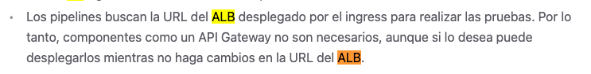

# Deployment View


This document presents the various diagrams indicating how the components defined in the architecture are to be deployed.


The runtime component model (orchestrators, microservices, shared database,
and Ingress) is documented in the [Functional View](./functional-view.md)
with the `components_third_iteration.puml` diagram.

## Deployment Model

### AWS EKS (production)

In production, the system runs on an AWS EKS cluster (provisioned by the
`eks` Terraform stack). Each of the eight workloads (five microservices and
three orchestrators) runs as a Deployment with its own pods and a ClusterIP
Service. All five data owning applications connect to a single shared RDS
PostgreSQL instance (the `1_database` Terraform stack), using their own
schema and role within that instance. Container images are pulled from the
ECR repositories created by the `2_registry` stack, and the database
credentials are provided by AWS Secrets Manager through the External
Secrets Operator (ESO).

External traffic enters through a single NGINX ingress controller
(the `microservices-ingress` Ingress resource) and is routed by path prefix
to the appropriate ClusterIP Service. The course project required an AWS ALB,
but the AWS Academy academic accounts do not allow ALB, so the NGINX
controller is used in both environments (see the "Ingress Deployment
Details" section below for the rationale).

### Local Minikube

Locally, the system is deployed using Docker containers orchestrated by
Kubernetes (Minikube). Each application runs in its own container and pod,
while all applications share a single Postgres database instance (the
`shared-db` Deployment in `k8s_entrega2/local-only/15-shared-db.yml`),
mirroring the cloud shared database model. External traffic enters through
the same NGINX ingress controller (the Minikube ingress addon) and is
routed by path prefix to the appropriate ClusterIP Service.


## Network Model
## Network Model

All services are of the ClusterIP type, as they only allow internal communication within the cluster. External traffic enters through the NGINX ingress controller Service (which exposes a NodePort on the Minikube node) and is routed by path prefix to the appropriate ClusterIP Service.
All services are of the ClusterIP type, as they only allow internal communication within the cluster. External traffic enters through the NGINX ingress controller Service (which exposes a NodePort on the Minikube node) and is routed by path prefix to the appropriate ClusterIP Service.

Data isolation between applications is enforced at the PostgreSQL level: each application uses its own database and role within the shared Postgres instance, with no cross-app queries or foreign keys. This model replaces the previous per-app NetworkPolicy approach and aligns with the cloud architecture where a single RDS instance serves all applications.
Data isolation between applications is enforced at the PostgreSQL level: each application uses its own database and role within the shared Postgres instance, with no cross-app queries or foreign keys. This model replaces the previous per-app NetworkPolicy approach and aligns with the cloud architecture where a single RDS instance serves all applications.


# New Components for Deployment Model (Entrega 2)


The following table documents every **new** component introduced in Entrega 2, per the required documentation format. It is the same table as in the [Functional View](./functional-view.md); both copies are kept in sync. Legacy components from Entrega 1 (`users_app`, `posts_app`, `offers_app`, `routes_app`) are not modified and are therefore not repeated here, except where their existing responsibilities are relevant to an integration.

| Componente | Código/Id | Tipo | Responsabilidad | Consideraciones de diseño | Integraciones |
|---|---|---|---|---|---|
| **RF-003 orchestrator** (`rf003_create_post_app`) | `RF003App` | Service | Exposes `POST /rf003/posts`. Orchestrates route resolution (find-or-create) and post creation as a single client-facing operation, fulfilling the "one host, one request" constraint for post creation. | Introduces a synchronous multi-hop call chain (Users → Routes → Posts) behind one request; must handle partial failure to keep data consistent (saga compensation: when the post stage fails with an integration error and the route was created in this flow, the orchestrator deletes it) and must not duplicate business logic already owned by Routes/Posts. Adds latency proportional to the number of downstream calls. | Calls `users_app` (validate bearer token via existing auth endpoint); calls `routes_app` (find route by `flightId`, or create if absent); calls `posts_app` (create post). All calls are synchronous HTTP/REST. |
| **RF-004 orchestrator** (`rf004_create_offer_app`) | `RF004App` | Service | Exposes `POST /rf004/posts/{id}/offers`. Orchestrates offer creation, ownership/expiration validation, and score calculation/persistence as a single client-facing operation. | Same multi-hop consistency concern as RF-003; additionally depends on the new `scores_app`: when the score stage fails with an integration error after the offer was created, the orchestrator compensates (deletes the just created offer) and answers 503, so no orphaned offer remains. Business rejections (400/404/412) pass through unchanged and never trigger compensation. | Calls `users_app` (auth); calls `posts_app` (validate post exists, not expired, not own post); calls `routes_app` (retrieve `bagCost` for score calculation); calls `offers_app` (create offer); calls `scores_app` (persist calculated score). All calls synchronous HTTP/REST. |
| **RF-005 orchestrator** (`rf005_query_post_app`) | `RF005App` | Service | Exposes `GET /rf005/posts/{id}`. Aggregates a post, its route, and its offers (sorted descending by score) into a single response, enforcing that only the post's owner may view it. | Read-heavy aggregation across 5 services in one request; must tolerate `scores_app` being unavailable per-offer (returning `score: null` for that offer) without failing the entire response: this is an explicit resilience requirement, not just a nice-to-have. Highest fan-out of the three orchestrators, so it's the most latency- and failure-sensitive. | Calls `users_app` (auth); calls `posts_app` (fetch post, validate ownership); calls `routes_app` (fetch route details); calls `offers_app` (fetch offers for the post); calls `scores_app` (fetch score per offer, nullable). All calls synchronous HTTP/REST. |
| **Score service** (`scores_app`) | `ScoresApp` | Service + Database (owns its own schema) | Owns the Utilidad (Score) entity. Persists a score value per offer so it can be retrieved later even if it changes over time; must not be a calculate-only/stateless component. | New bounded context introduced solely for Entrega 2; its own availability directly affects RF-004 (a score stage failure triggers the compensating action and a 503, so no orphaned offer remains) and RF-005 (a missing or unreachable score reads as `null` per-offer rather than erroring). API and schema design are fully owned by the team since the document does not define them. | Written to by `rf004_create_offer_app` (persist score on offer creation); read by `rf005_query_post_app` (retrieve score per offer). No direct access to any other service's data: reads/writes only its own schema in the shared database. |
| **Ingress** (`ingress`) | `Ingress` | Infrastructure (network routing) | Single public entry point for the entire system. Routes incoming HTTP requests by path prefix to the correct backend Service (orchestrators or legacy apps), so the client only ever sees one host and makes one request per requirement. | Not a business component: pure infrastructure. Becomes the single point through which all traffic flows, so its configuration correctness is critical (a routing mistake here breaks the requirement that all 7 endpoint groups be reachable). The course project required an AWS ALB, but the AWS Academy academic accounts do not allow ALB, so the NGINX ingress controller is used in both environments. | Routes to: `users-app-service` (`/users/*`), `posts-app-service` (`/posts/*`), `offers-app-service` (`/offers/*`), `routes-app-service` (`/routes/*`), `rf003-create-post-service` (`/rf003/posts`), `rf004-create-offer-service` (`/rf004/posts/{id}/offers`), `rf005-query-post-service` (`/rf005/posts/{id}`). HTTP only; no business logic. |
| **Shared database** (`shared_db`) | `SharedDb` | Database | Single managed PostgreSQL instance (AWS RDS) hosting all applications' data. Each application's data is logically isolated (per-app schema and DB role/grants): no cross-app queries or foreign keys, preserving the "each app owns its data" principle despite sharing one physical instance. | Replaces Entrega 1's one-database-per-app model to reduce cloud cost/footprint, as required by the document ("una sola base de datos... que albergará todas las tablas desacopladas"). Isolation between apps' data is enforced at the PostgreSQL level (schema + role grants), not at the network level, since a single RDS instance cannot be split by K8s NetworkPolicy. Introduces a shared operational dependency: if RDS is unavailable, all data-owning apps are affected simultaneously (a trade-off accepted for cost/time reasons). | Read/written by `users_app`, `posts_app`, `offers_app`, `routes_app`, and `scores_app`, each scoped to its own schema via its own database role. Port 5432, PostgreSQL protocol. No orchestrator or client accesses this database directly: always through the owning app's API. |

# New Deployment Model (Entrega 3)

")

The model above extends the deployment model of the previous section: the
existing EKS workloads, the shared RDS database, and the single NGINX ingress
entry point remain unchanged, and the new units of both requirements of
Entrega 3 are added to the same cluster and to the same single external host.
All cloud resources live in the `us-east-1` region, and every Kubernetes
workload uses the default namespace only.

## Single entry point and routing

External traffic keeps entering through the single external host served by the
NGINX ingress controller (its Service is exposed as a LoadBalancer). The
Ingress now routes three additional path prefixes on top of the existing
`/users/*`, `/posts/*`, `/offers/*`, `/routes/*`, and orchestrator routes:
`/credit-cards/*` reaches the `credit-cards-service` ClusterIP Service, and
`/native/*` reaches the `truenative-service` ClusterIP Service. The identity
verification callback published by TrueNative reaches the
`user-verification-callback-service` ClusterIP Service through the same host,
so no extra external entry point is introduced.

## Routing decision (TASK-002)

**Decision:** the single external host keeps being the NGINX ingress
controller (the `microservices-ingress` Ingress resource defined in
`k8s_entrega2/zz-ingress.yml`), extended with the new path prefixes. No API
Gateway and no BFF service are introduced.

**Rationale:**

- The project document does not specify a gateway technology, so routing by
  path prefix on the existing NGINX controller is the choice with the least
  new surface: the controller, the Ingress resource, and the host already
  exist in both environments, and the decision reuses them.
- Every route prefix maps to one independently deployed component (one
  Deployment and one ClusterIP Service each), so routing stays at the network
  layer and no business logic is added to the entry point.
- The client keeps making exactly one HTTP request to one host per
  requirement: the request enters the single host and the Ingress forwards it
  by path prefix to the owning component, which coordinates the rest of the
  flow server side.
- The existing `/users/*` rule (and every other existing rule) is unchanged;
  the rule set only grows the `/credit-cards` prefix (this task) and the
  `/native` prefix (added by the TrueNative deployment task).

The current rule set of the single host is:

| Path prefix | Backend Service | Component |
|---|---|---|
| `/users/*` | `users-app-service` | `users_app` (unchanged) |
| `/posts/*` | `posts-app-service` | `posts_app` |
| `/offers/*` | `offers-app-service` | `offers_app` |
| `/routes/*` | `routes-app-service` | `routes_app` |
| `/scores/*` | `scores-app-service` | `scores_app` |
| `/rf003/*` | `rf003-create-post-service` | `rf003_create_post_app` |
| `/rf004/*` | `rf004-create-offer-service` | `rf004_create_offer_app` |
| `/rf005/*` | `rf005-query-post-service` | `rf005_query_post_app` |
| `/credit-cards/*` | `credit-cards-service` | `credit_cards_app` (Entrega 3) |
| `/native/*` | `truenative-service` | `truenative` (Entrega 3) |

One planned rule is documented here for completeness: the identity
verification callback will be routed to `user-verification-callback-service`
through the same host under the more specific prefix
`/users/verify/callback` (its rule is added by the callback task). NGINX
matches the longest prefix first, so that rule will not alter the existing
`/users/*` behavior.

The routing rules are also captured graphically in the deployment view
(`deployment_third_iteration.puml`) and in the new network model
(`networks_third_iteration.puml`, section "New Network Model" below).

## Runtimes

- `credit_cards_app` runs as a Kubernetes Deployment in the default namespace,
  with its own pod and ClusterIP Service, exactly like the other web
  applications.
- `user_verification_callback` runs as a Kubernetes Deployment in the default
  namespace, with its own pod and ClusterIP Service. It is the web component
  that receives the identity verification callback from TrueNative.
- `true_native` runs as a Kubernetes Deployment in the default namespace using
  the provided container image `ghcr.io/misw-4301-desarrollo-apps-en-la-nube/true-native:2.0.0`.
  It is deployed on the cluster (not outside of it), so the callback and the
  card polling reach it through the cluster network or through the
  `/native/*` prefix of the single external host.
- `card_worker` runs as an AWS Lambda function (packaged as a container image)
  outside the cluster. It is the only non Kubernetes unit of the new
  requirements, and it exists because the card verification response from
  TrueNative takes up to 30 seconds while the initial card registration
  response must stay under 5 seconds: the web component answers first and the
  function completes the verification afterwards.

## Data stores

- The five legacy data owning applications keep reading and writing the shared
  RDS PostgreSQL instance (port 5432), each through its own schema and role.
- `credit_cards_app` owns a dedicated DynamoDB table for the card data,
  isolated from the shared PostgreSQL instance. `card_worker` is the only
  other unit allowed to access that table, and it reads and writes it while
  completing the verification.
- `user_verification_callback` does not own a data store: it updates the user
  verification status through the `users_app` API, so the user data stays in
  the shared RDS instance under the `users_app` schema.

## Messaging and email mechanism

- `card_verification_queue` is an SQS queue that carries the card verification
  events. `credit_cards_app` sends an event to the queue (asynchronous)
  immediately after registering the card, and `card_worker` consumes the
  queue (asynchronous polling), calls TrueNative to complete the verification,
  updates the DynamoDB table, and publishes the result.
- The email mechanism is the SNS email notification: the result of the card
  verification (published by `card_worker`) and the result of the identity
  verification (published by `user_verification_callback`) are sent to the
  SNS email topics, which deliver the notification to the user. The recipient
  address comes from the `EMAIL_TO_NOTIFY` key of the
  `secrets-pipeline-native-map` secret in AWS Secrets Manager, which the
  deploy pipeline populates from the GitHub secret of the same name. The
  deploy pipeline also stores the TrueNative credentials in that same secret,
  so the infrastructure can read them at deploy time.
- The web components (`credit_cards_app` and `user_verification_callback`)
  never run background tasks: all the asynchronous work is delegated to the
  queue, the Lambda function, and the SNS topics, which keeps the web
  components within the course restriction on asynchronous execution.

## Infrastructure and manifests

The deploy pipeline (`ci_entrega2_deploy.yml`) deploys everything declared in
`config.yaml`: it applies the Terraform stacks in `tf_stacks` (the existing
`1_database`, `2_registry`, and `eks` stacks, plus the stack or stacks that
provision the new infrastructure: the DynamoDB table, the SQS queue, the SNS
topics, and the Lambda function), and then applies the Kubernetes manifests in
`k8s_manifests` (the `k8s_entrega2` directory, extended with the manifests of
the three new workloads and the updated Ingress). No other deployment mechanism
is used: the complete model of this section is deployed in a single pipeline
run.

## Ingress Deployment Details

The single Ingress resource is defined in `k8s_entrega2/zz-ingress.yml`
(name: `microservices-ingress`) and is the same resource in both
environments. The rule set is extended by each delivery: the current rules
route the prefixes of the legacy apps, the orchestrators, and, since
Entrega 3, the `/native` prefix to the TrueNative service (the
`/credit-cards` prefix is added by the credit cards task).

### Local Minikube - NGINX Ingress

For local development, the Ingress uses `ingressClassName: nginx` to route
through the Minikube NGINX ingress addon.

Steps to deploy locally:
1. Enable the NGINX ingress addon: `minikube addons enable ingress`
2. Apply the local secrets, the shared database, the app manifests, and the
   ingress (in that order; see the
   [Kubernetes Resources section](./README.md#kubernetes-resources))
3. Start `minikube tunnel` in a separate terminal, then the Ingress is
   reachable at `http://localhost:80`:
   ```bash
   curl http://localhost:80/<path>/ping
   ```

The full local sequence (clean, start, build, apply, verify) is automated in
`scripts/local-deploy.sh` and `scripts/local-verify.sh`.

### AWS EKS production - NGINX Ingress (ALB not available)

The course project required an AWS ALB for the cloud deployment, but the
AWS Academy academic accounts do not allow ALB, so this project implements
the NGINX ingress controller in both environments, as learned in the course
tutorials. The same `microservices-ingress` resource
(`ingressClassName: nginx`) is applied on EKS; the NGINX controller runs as
a Deployment inside the cluster and its Service is exposed as a LoadBalancer,
which serves as the single entry point. The step by step instructions are in
the [README ingress configurations section](./README.md#ingress-configurations-two-environments).

## New Network Model


## New Network Model (Entrega 3)

")

The network model of Entrega 3 extends the previous one: the same NGINX
ingress controller stays the only entry point into the cluster, and the new
units are added as ClusterIP Services inside the same default namespace.
The single external host now routes the prefixes of the legacy apps, the
orchestrators, and the two new prefixes of this delivery: `/credit-cards/*`
to `credit-cards-service` (the `credit_cards_app` Deployment) and
`/native/*` to `truenative-service` (the `truenative` Deployment). The
`/users/*` rule keeps its original behavior and backend
(`users-app-service`, port 8000); the only planned change under `/users` is
the more specific callback prefix, which the callback task will add and which
does not alter the existing rule because NGINX matches the longest prefix
first.

The routing rules shown in the diagram are the rules of the
`microservices-ingress` Ingress resource in `k8s_entrega2/zz-ingress.yml`.
The diagram shows the `credit-cards-service` rule even before the
`credit_cards_app` manifest exists, because the rule is part of this
decision and the backend Service appears together with the app in its own
task; until then the rule has no endpoints and the prefix answers 503.

The cloud deployment uses the Terraform stacks under `terraform/stacks/`
(`0_storage`, `1_database`, `2_registry`, and `eks`) to provision
infrastructure on AWS before deploying application workloads via Kubernetes.
The active deploy order is the one declared in `config.yaml` `tf_stacks`:
`1_database` → `2_registry` → `eks`. The `0_storage` stack is commented out
in `config.yaml` because the S3 bucket it creates must exist before any
stack can initialize its S3 state backend, so it cannot be part of the
pipeline order; it is provisioned manually in `dev` environments with the
custom automation scripts in `scripts/terraform_scripts/` (see the
[Terraform Deployment Guide](./terraform-deployment.md) for the full
explanation).


The deployment pipeline (`ci_entrega2_deploy.yml`) orchestrates:

1. **Terraform applies** each stack in `tf_stacks` order (`1_database` → `2_registry` → `eks`)
2. **Docker images** are built and pushed to Amazon ECR repositories
3. **Kubernetes manifests** are applied to the EKS cluster for workload deployment

In the new architecture, network-layer isolation (via Kubernetes NetworkPolicies) has been replaced by PostgreSQL-level role and database isolation. Each application uses its own database and role within the shared Postgres instance, so there is no need for per-app NetworkPolicy rules. The diagram above shows the logical connectivity of all services in Entrega 2: applications communicate with each other over HTTP/REST (for orchestrator chains), and all applications connect to the single shared Postgres instance using their own credentials.

# Note: The ALB was not used

The course project required an AWS ALB, but the AWS Academy academic
accounts do not allow ALB. 



For this reason the project uses the NGINX
ingress controller in both environments:


This misinformation costed me a lot of development time.