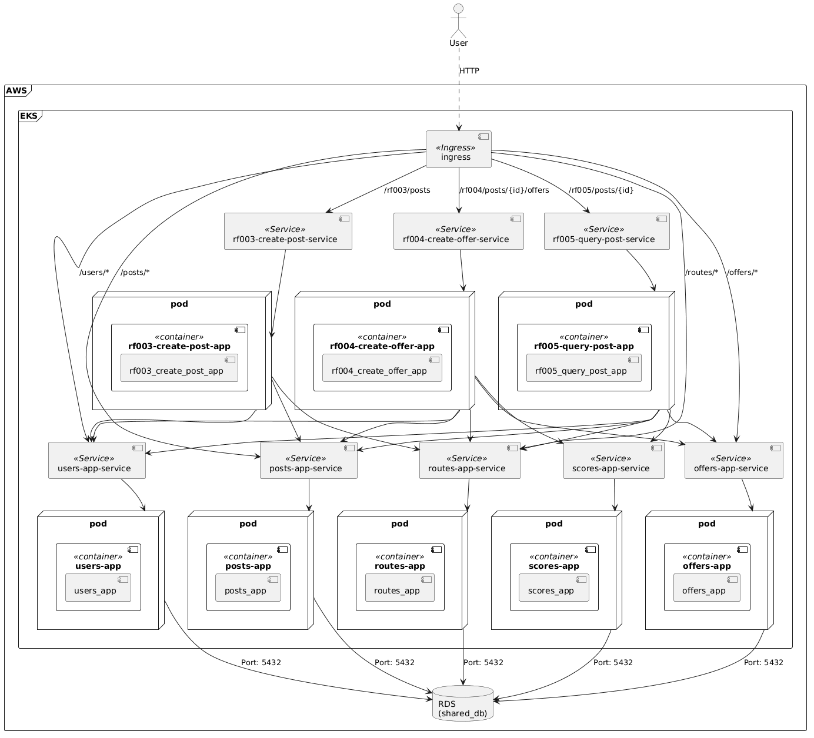
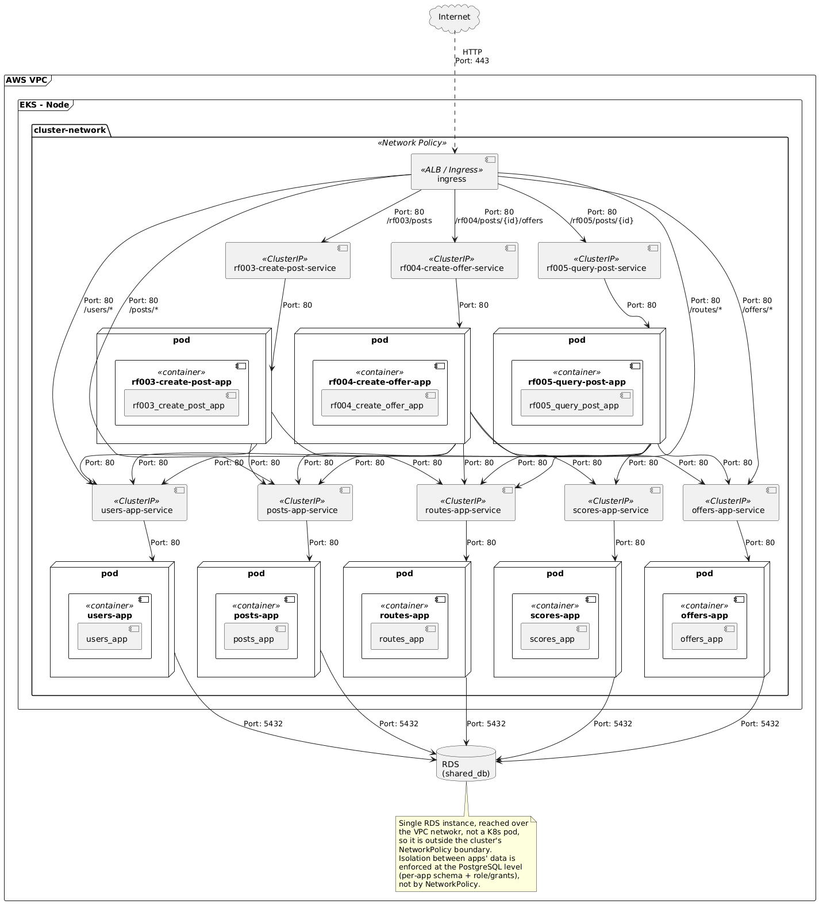
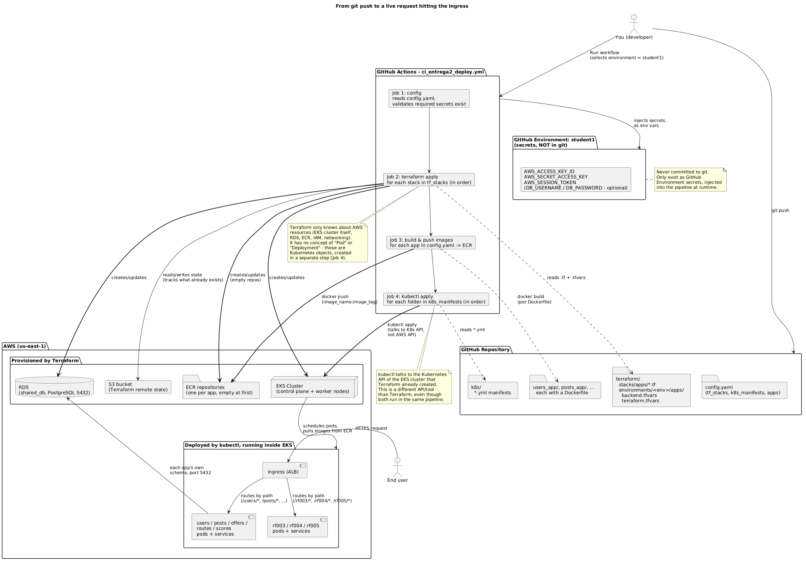
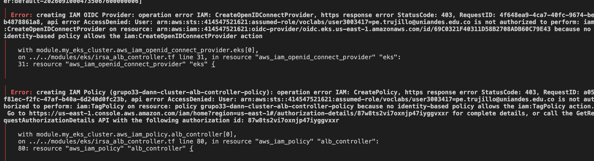

# Deployment View


This document presents the various diagrams indicating how the components defined in the architecture are to be deployed.


## Deployment Model
Locally, the system is deployed using Docker containers orchestrated by Kubernetes. Each application runs in its own container and pod, while all applications share a single Postgres database instance (the `shared-db` Deployment in `k8s_entrega2/local-only/15-shared-db.yml`). In production, the shared database is an AWS RDS PostgreSQL instance.

Communication with the applications takes place via the HTTP protocol, utilizing the REST API defined in the functional view. External traffic enters through a single NGINX ingress controller Service (exposing a NodePort on the Minikube node) and is routed by path prefix to the appropriate ClusterIP Service.


## Network Model

All services are of the ClusterIP type, as they only allow internal communication within the cluster. External traffic enters through the NGINX ingress controller Service (which exposes a NodePort on the Minikube node) and is routed by path prefix to the appropriate ClusterIP Service.

Data isolation between applications is enforced at the PostgreSQL level: each application uses its own database and role within the shared Postgres instance, with no cross-app queries or foreign keys. This model replaces the previous per-app NetworkPolicy approach and aligns with the cloud architecture where a single RDS instance serves all applications.


# New Components for Deployment Model (Entrega 2)



The following table documents every **new** component introduced in Entrega 2, per the required documentation format. Legacy components from Entrega 1 (`users_app`, `posts_app`, `offers_app`, `routes_app`) are not modified and are therefore not repeated here, except where their existing responsibilities are relevant to an integration.

| Component | Component Name | Component Code/ID | Type | Responsibility | Design Considerations | Integrations |
|---|---|---|---|---|---|---|
| **RF-003 orchestrator** | `rf003_create_post_app` | `RF003App` | Service | Exposes `POST /rf003/posts`. Orchestrates route resolution (find-or-create) and post creation as a single client-facing operation, fulfilling the "one host, one request" constraint for post creation. | Introduces a synchronous multi-hop call chain (Users → Routes → Posts) behind one request; must handle partial failure to keep data consistent (compensating action or fail-fast design) and must not duplicate business logic already owned by Routes/Posts. Adds latency proportional to the number of downstream calls. | Calls `users_app` (validate bearer token via existing auth endpoint); calls `routes_app` (find route by `flightId`, or create if absent); calls `posts_app` (create post). All calls are synchronous HTTP/REST. |
| **RF-004 orchestrator** | `rf004_create_offer_app` | `RF004App` | Service | Exposes `POST /rf004/posts/{id}/offers`. Orchestrates offer creation, ownership/expiration validation, and score calculation/persistence as a single client-facing operation. | Same multi-hop consistency concern as RF-003; additionally depends on the new `scores_app`, which is explicitly allowed to be unavailable—this orchestrator must degrade gracefully (for example, still create the offer, treat the score as pending) rather than fail the whole request when scoring is down. | Calls `users_app` (auth); calls `posts_app` (validate post exists, not expired, not own post); calls `routes_app` (retrieve `bagCost` for score calculation); calls `offers_app` (create offer); calls `scores_app` (persist calculated score). All calls synchronous HTTP/REST. |
| **RF-005 orchestrator** | `rf005_query_post_app` | `RF005App` | Service | Exposes `GET /rf005/posts/{id}`. Aggregates a post, its route, and its offers (sorted descending by score) into a single response, enforcing that only the post's owner may view it. | Read-heavy aggregation across 5 services in one request; must tolerate `scores_app` being unavailable per-offer (returning `score: null` for that offer) without failing the entire response—this is an explicit resilience requirement, not just a nice-to-have. Highest fan-out of the three orchestrators, so it's the most latency- and failure-sensitive. | Calls `users_app` (auth); calls `posts_app` (fetch post, validate ownership); calls `routes_app` (fetch route details); calls `offers_app` (fetch offers for the post); calls `scores_app` (fetch score per offer, nullable). All calls synchronous HTTP/REST. |
| **Score service** | `scores_app` | `ScoresApp` | Service (shares database) | Owns the Utilidad (Score) entity. Persists a score value per offer so it can be retrieved later even if it changes over time; must not be a calculate-only/stateless component. | New bounded context introduced solely for Entrega 2; its own availability directly affects RF-004 (must still allow offer creation if scoring temporarily fails) and RF-005 (must return `null` per-offer rather than erroring). API and schema design are fully owned by the team since the document does not define them. | Written to by `rf004_create_offer_app` (persist score on offer creation); read by `rf005_query_post_app` (retrieve score per offer). No direct access to any other service's data—reads/writes only its own database in the shared Postgres instance via its own role. |
| **Ingress** | `ingress` | `Ingress` | Infrastructure—network routing | Single public entry point for the entire system. Routes incoming HTTP requests by path prefix to the correct backend Service (orchestrators or legacy apps), so the client only ever sees one host and makes one request per requirement. | Not a business component—pure infrastructure. Becomes the single point through which all traffic flows, so its configuration correctness is critical (a routing mistake here breaks the "no exceptions" requirement that all 7 endpoint groups be reachable). Backed by an AWS ALB via the AWS Load Balancer Controller. | Routes to: `users-app-service` (`/users/*`), `posts-app-service` (`/posts/*`), `offers-app-service` (`/offers/*`), `routes-app-service` (`/routes/*`), `rf003-create-post-service` (`/rf003/posts`), `rf004-create-offer-service` (`/rf004/posts/{id}/offers`), `rf005-query-post-service` (`/rf005/posts/{id}`). HTTP only; no business logic. |
| **Shared database** | `shared_db` | `SharedDb` | Database | Single managed PostgreSQL instance (AWS RDS) hosting all applications' data. Each application's data is logically isolated (per-app schema and DB role/grants)—no cross-app queries or foreign keys, preserving the "each app owns its data" principle despite sharing one physical instance. | Replaces Entrega 1's one-database-per-app model to reduce cloud cost/footprint, as required by the document ("una sola base de datos... que albergará todas las tablas desacopladas"). Isolation between apps' data is enforced at the PostgreSQL level (schema + role grants), not at the network level, since a single RDS instance cannot be split by K8s NetworkPolicy. Introduces a shared operational dependency: if RDS is unavailable, all data-owning apps are affected simultaneously (a trade-off accepted for cost/time reasons). | Read/written by `users_app`, `posts_app`, `offers_app`, `routes_app`, and `scores_app`, each scoped to its own schema via its own database role. Port 5432, PostgreSQL protocol. No orchestrator or client accesses this database directly—always through the owning app's API. |

## Ingress Deployment Details

### Local Minikube - NGINX Ingress

For local development, `k8s_entrega2/zz-ingress.yml` (Ingress resource
`microservices-ingress`) is configured with `ingressClassName: nginx` to use
the Minikube NGINX ingress addon. This is the default configuration for
local testing.

#### Steps to deploy locally:
1. Enable the NGINX ingress addon: `minikube addons enable ingress`
2. Apply secrets and ingress: `kubectl apply -f k8s_entrega2/00-secrets.yml -f k8s_entrega2/zz-ingress.yml`
3. The NGINX controller exposes a dynamic NodePort on the Minikube node:
   ```bash
   INGRESS_PORT=$(kubectl get service ingress-nginx-controller \
     -n ingress-nginx -o jsonpath='{.spec.ports[0].nodePort}')
   curl http://$(minikube ip):${INGRESS_PORT}/<path>/ping
   ```

The full local sequence (clean, start, build, apply, verify) is automated in
`scripts/local-deploy.sh` and `scripts/local-verify.sh`.

### AWS EKS production - ALB Ingress

For cloud deployment, change the Ingress configuration to use the AWS Load Balancer Controller. See the [README ingress configurations section](../README.md#ingress-configurations-two-environments) for full step by step instructions.

## New Network Model 



## Terraform Infrastructure Deployment

The cloud deployment uses three Terraform stacks (network, data, compute) to provision infrastructure on AWS before deploying application workloads via Kubernetes.



The deployment pipeline (`ci_entrega2_deploy.yml`) orchestrates:

1. **Terraform applies** each stack in order (network -> data -> compute)
2. **Docker images** are built and pushed to Amazon ECR repositories
3. **Kubernetes manifests** are applied to the EKS cluster for workload deployment

In the new architecture, network-layer isolation (via Kubernetes NetworkPolicies) has been replaced by PostgreSQL-level role and database isolation. Each application uses its own database and role within the shared Postgres instance, so there is no need for per-app NetworkPolicy rules. The diagram above shows the logical connectivity of all services in Entrega 2: applications communicate with each other over HTTP/REST (for orchestrator chains), and all applications connect to the single shared Postgres instance using their own credentials.


# Note: 

Sadly the AWS Academy doesn't allow to use ALB stacks. For this reason I'm using NGINX:


