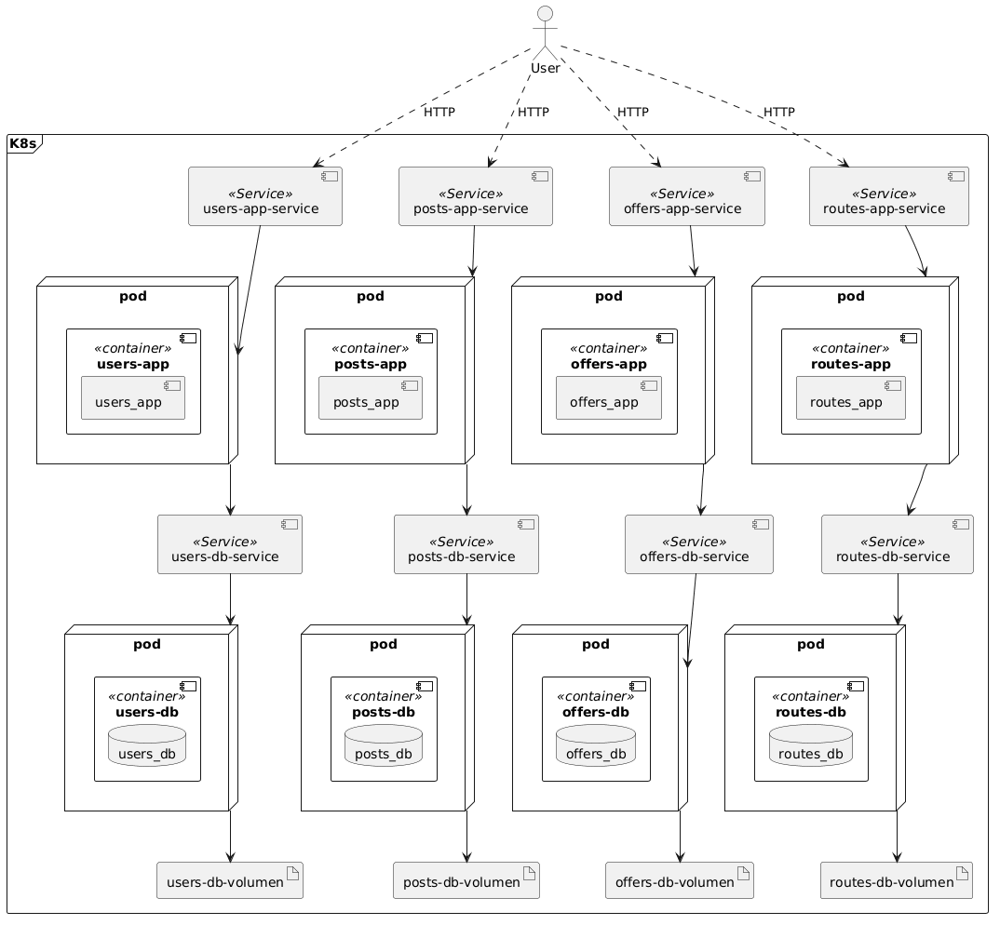
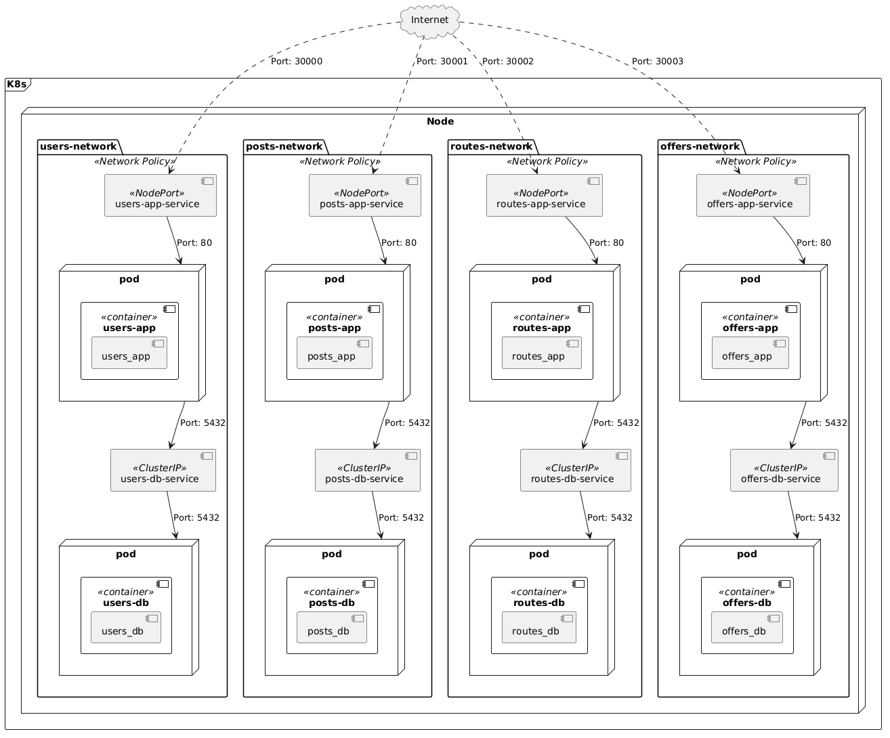

# Deployment View

This document presents the various diagrams indicating how the components defined in the architecture are to be deployed.

## Deployment Model
Locally, the system will be deployed using Docker containers; each component as well as its respective databases will run in an independent container.

Communication with the applications will take place via the HTTP protocol, utilizing the REST API defined in the functional view.

In the first release, the applications are completely decoupled and do not communicate with one another. Additionally, the databases run using the same model as the applications an approach that will change in future releases.

As you can notice, the databases are configured with volumes.

## Network Model 

Each application has a network defined with its corresponding database. This setup prevents one application from accessing another's data, thereby ensuring isolation and low coupling between applications.

The model also shows that the database services are of the ClusterIP type, as they will only allow internal communication, whereas the application services are of the NodePort type to enable communication from outside the cluster.