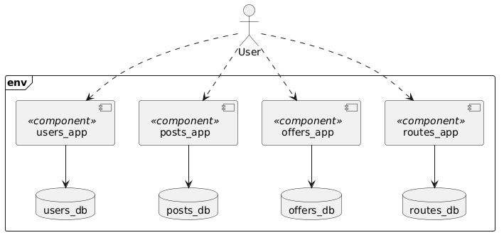

# Functional View

This model presents some of the runtime components defined for the architecture. It does not show every component expected in the system, but rather those required for the project's first iteration.

Each runtime component exposes a REST API. The whole corresponding documentation about each component (app, database, API, deployment, etc) is listed below.

- [Users App](apps/users_app.md)
- [Routes App](apps/routes_app.md)
- [Posts App](apps/posts_app.md)
- [Offers App](apps/offers_app.md)