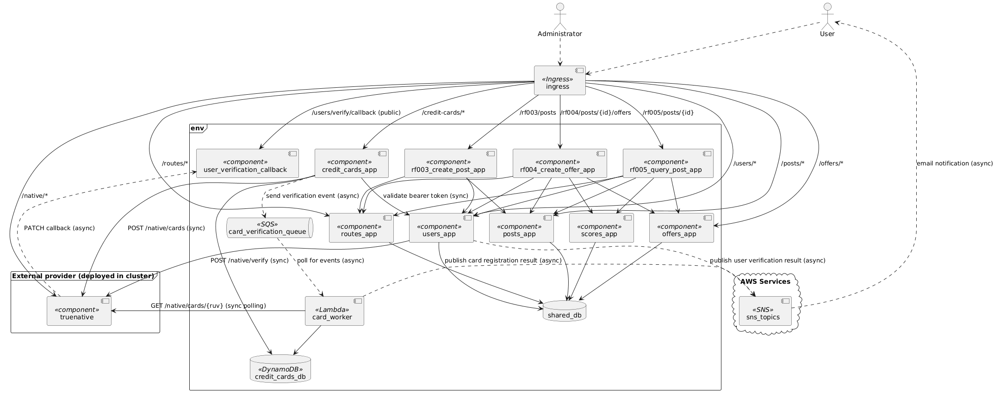

# Functional View

This model presents the runtime components defined for the architecture. It includes every component implemented in the previous deliveries (the three orchestrators, the five microservices, the shared database, and the Ingress entry point) plus the components introduced in Entrega 3: the `credit_cards_app` service, the `card_worker` Lambda function, the `card_verification_queue` (SQS), the `user_verification_callback` service, the external `truenative` platform, and the SNS topics used for email notification. Each runtime component exposes a REST API (except the queue, the topics, and the databases). The whole corresponding documentation about each component (app, database, API, deployment, etc) is listed below.

- [Users App](apps/users_app.md)
- [Routes App](apps/routes_app.md)
- [Posts App](apps/posts_app.md)
- [Offers App](apps/offers_app.md)
- [Scores App](apps/scores_app.md)
- [RF-003 Orchestration App](apps/rf003_create_post_app.md)
- [RF-004 Orchestration App](apps/rf004_create_offer_app.md)
- [RF-005 Orchestration App](apps/rf005_query_post_app.md)

## New Components (Entrega 3)

The following table documents every **new** component introduced in Entrega 3, per the required documentation format. Legacy components from the previous deliveries (`users_app`, `posts_app`, `offers_app`, `routes_app`, `scores_app`, the three orchestrators, the Ingress, and the shared database) are not repeated here, except where their existing responsibilities are relevant to an integration. The component codes in the second column are the same identifiers used in the diagram above.

| Componente | Código/Id | Tipo | Responsabilidad | Consideraciones de diseño | Integraciones |
|---|---|---|---|---|---|
| **Credit Cards service** (`credit_cards_app`) | `CreditCardsApp` | Service + Database (owns the CreditCard entity) | Exposes the CreditCard API: `POST /credit-cards`, `GET /credit-cards`, `GET /credit-cards/count`, `GET /credit-cards/ping`, and `POST /credit-cards/reset`. Validates the request (card number format, expiration, duplicates), validates the caller's bearer token, derives the issuer, and persists the card with status `POR_VERIFICAR`, the payment token, the last four digits, and the RUV. Then it publishes the verification event to the queue and answers the client. | The initial response must return in less than 5 seconds, so the synchronous path performs only token validation, one TrueNative tokenization call, and one database write; the slow verification (up to 30 seconds) is delegated asynchronously to `CardWorker` through the queue. The restriction that forbids background tasks, threads, and asyncio in the web components is respected because no asynchronous work runs inside this process. Owns the CreditCard data in its own DynamoDB table, with no access to any other application's data. If TrueNative cannot generate the token, nothing is stored and the error is returned to the user. | `UsersApp` (`GET /users/me` to validate the bearer token and resolve the card owner; synchronous HTTP/REST); `TrueNative` (`POST /native/cards` to request the card token; synchronous HTTP/REST with the `Authorization: Bearer <SECRET_TOKEN>` header); `CardQueue` (send the verification event; asynchronous, SQS send message protocol); `CreditCardsDb` (read and write the CreditCard entity; synchronous, DynamoDB protocol). |
| **Card verification worker** (`card_worker`) | `CardWorker` | Serverless function (AWS Lambda) | Consumes card verification events from the queue, polls TrueNative until the card reaches a terminal state (`APROBADA` or `RECHAZADA`, within the 30 second SLA), updates the card status and `updatedAt` in the database with the current UTC date, and publishes the email notification of the result to the SNS topics. | Separate component, so the web service never runs long polling loops in the request path (the restriction that forbids asynchronous execution strategies in the web components is respected: the function itself is synchronous code, invoked by the event). The polling loop is a simple sequential loop with a bounded number of attempts. The queue provides at least once delivery, so the status update is idempotent by card id. Transient TrueNative errors trigger a retry by redelivering the event; a rejected card and a failed tokenization are distinct outcomes (a rejected card is stored as `RECHAZADA`, a failed tokenization stores nothing, as decided by `CreditCardsApp` before the event is published). | `CardQueue` (poll verification events; asynchronous, SQS receive message protocol); `TrueNative` (`GET /native/cards/{ruv}` to check the verification state; synchronous HTTP/REST polling with the `Authorization: Bearer <SECRET_TOKEN>` header); `CreditCardsDb` (update card status and `updatedAt`; synchronous, DynamoDB protocol); `SnsTopics` (publish the card registration result; asynchronous, SNS publish protocol, delivered as email). |
| **Card verification queue** (`card_verification_queue`) | `CardQueue` | Message queue (AWS SQS) | Decouples card creation (synchronous, response in less than 5 seconds) from card verification (asynchronous, up to 30 seconds). Buffers verification events when TrueNative is slow or when demand spikes, so the credit cards service never blocks on the external platform. | Adds at least once delivery, which forces the consumer to be idempotent (the worker updates by card id, so a redelivered event only rewrites the same terminal state). The queue is the single asynchronous seam of the RF-006 flow, and it is the component that makes the event driven pattern explicit in the architecture. Operational considerations: queue permissions scoped to the producer and consumer roles only, and a dead letter policy so a permanently failing event does not block the queue. | `CreditCardsApp` (receives the verification event; asynchronous, SQS send message protocol); `CardWorker` (delivers the verification event; asynchronous, SQS receive message protocol). |
| **User verification callback** (`user_verification_callback`) | `UserVerificationCallback` | Service (FastAPI) | Receives the asynchronous callback from TrueNative with the identity verification result (RUV, score, and `verifyToken`). Validates the SHA256 signature of the message, resolves the user from the transaction identifier, updates the user status (`VERIFICADO` when the score is greater than 60, `NO_VERIFICADO` when the score is 60 or lower, per the team decision documented in the [RF-007 Sequence View](./rf007-sequence-view.md)) and `updatedAt` through the users API, and publishes the email notification of the result to the SNS topics. | Separate component, so `UsersApp` does not expose an unauthenticated public route and does not mix the webhook verification logic (signature check, score mapping) with the user domain rules. The webhook URL is public by design (TrueNative has no authorization mechanism for callbacks), so the SHA256 check over `SECRET_TOKEN`, RUV, and score is the only authorization, and a message that fails the check is discarded. The user status update is performed through the `UsersApp` API, so the data ownership rule (no direct access to another application's database) is preserved. The component answers 200 to TrueNative only when the update is applied. | `TrueNative` (receives the `PATCH` callback; asynchronous HTTP/REST, initiated by TrueNative); `UsersApp` (update user status and `updatedAt`; synchronous HTTP/REST); `SnsTopics` (publish the user verification result; asynchronous, SNS publish protocol, delivered as email). |
| **TrueNative** (`truenative`) | `TrueNative` | External service (identity verification and card tokenization, provided image) | External platform provided by the course (image `ghcr.io/misw-4301-desarrollo-apps-en-la-nube/true-native:2.0.0`). For cards, it generates the 256 character payment token on registration and performs the verification that ends in `APROBADA` or `RECHAZADA` (polling model, 30 second SLA). For identities, it analyzes the provided user data and answers with a score from 1 to 100 (webhook model, 120 second SLA). | External, non modifiable component: its latency is the main driver of the asynchronous design in both requirements (the client never waits for it). It is configured with the mandatory `SECRET_TOKEN` environment variable (a random string generated by the team and stored as a Kubernetes Secret, never committed in plaintext; the manifest declares the `truenative-secret` object and the container reads it through `secretKeyRef`, while the value of that secret is substituted at apply time in both environments) and with the optional `SUCCESS_RATE`, `MAX_WEBHOOK_DELAY`, and `MAX_POLL_DELAY` variables that simulate the behavior of a real platform. All client applications must send the secret token in the `Authorization` header of every request. | `UsersApp` (receives `POST /native/verify` with the user data and the callback URL; synchronous HTTP/REST, `Authorization: Bearer <SECRET_TOKEN>` header); `UserVerificationCallback` (sends the `PATCH` callback with the verification result; asynchronous HTTP/REST); `CreditCardsApp` (receives `POST /native/cards` with the card data; synchronous HTTP/REST, `Authorization: Bearer <SECRET_TOKEN>` header); `CardWorker` (receives `GET /native/cards/{ruv}` polling requests; synchronous HTTP/REST, `Authorization: Bearer <SECRET_TOKEN>` header). |
| **SNS email topics** (`sns_topics`) | `SnsTopics` | Notification (AWS SNS topics with email protocol subscriptions) | Sends the mandatory email notification to the user for both requirements: the identity verification result (RF-007) and the card registration result (RF-006). The message content includes the final status, the RUV generated by TrueNative, and the user or card data used in the process. The subscription email address is read from the `EMAIL_TO_NOTIFY` key of the `secrets-pipeline-native-map` secret in AWS Secrets Manager, as required by the project. | The mechanism recommended by the project document. One subscription is created per topic during the Terraform deployment, and the subscription must be confirmed once, by clicking the confirmation link that SNS sends to the address, before any email is delivered; while the subscription is not confirmed, SNS discards the messages (this manual step is documented in the README). Decouples the producers (the callback and the worker) from the email delivery mechanism, so the producers only publish a message and never handle SMTP or provider credentials. | `UserVerificationCallback` (publishes the user verification result; asynchronous, SNS publish protocol); `CardWorker` (publishes the card registration result; asynchronous, SNS publish protocol); user mailbox (delivers the notification; asynchronous, email protocol). |

## Existing components modified in Entrega 3

`UsersApp` is the only component from the previous deliveries that is modified in this delivery, and the change is limited to the rule defined in the project document: the service no longer generates nor verifies tokens when the user is not in the `VERIFICADO` status. A user in the `POR_VERIFICAR` or `NO_VERIFICADO` status cannot authenticate, cannot refresh a token, and cannot use the `GET /users/me` endpoint with a bearer token. It also exposes the internal endpoint used by `UserVerificationCallback` to update the user status after the identity verification finishes. All the remaining endpoints and behaviors of the service are unchanged. The other legacy components (`PostsApp`, `OffersApp`, `RoutesApp`, `ScoresApp`, and the three orchestrators) are not modified and continue to work as documented in the previous deliveries.

## New Components (Entrega 2)

The following table documents every **new** component introduced in Entrega 2, per the required documentation format. Legacy components from Entrega 1 (`users_app`, `posts_app`, `offers_app`, `routes_app`) are not modified and are therefore not repeated here, except where their existing responsibilities are relevant to an integration.

| Componente | Código/Id | Tipo | Responsabilidad | Consideraciones de diseño | Integraciones |
|---|---|---|---|---|---|
| **RF-003 orchestrator** (`rf003_create_post_app`) | `RF003App` | Service | Exposes `POST /rf003/posts`. Orchestrates route resolution (find-or-create) and post creation as a single client-facing operation, fulfilling the "one host, one request" constraint for post creation. | Introduces a synchronous multi-hop call chain (Users → Routes → Posts) behind one request; must handle partial failure to keep data consistent (saga compensation: when the post stage fails with an integration error and the route was created in this flow, the orchestrator deletes it) and must not duplicate business logic already owned by Routes/Posts. Adds latency proportional to the number of downstream calls. | Calls `users_app` (validate bearer token via existing auth endpoint); calls `routes_app` (find route by `flightId`, or create if absent); calls `posts_app` (create post). All calls are synchronous HTTP/REST. |
| **RF-004 orchestrator** (`rf004_create_offer_app`) | `RF004App` | Service | Exposes `POST /rf004/posts/{id}/offers`. Orchestrates offer creation, ownership/expiration validation, and score calculation/persistence as a single client-facing operation. | Same multi-hop consistency concern as RF-003; additionally depends on the new `scores_app`: when the score stage fails with an integration error after the offer was created, the orchestrator compensates (deletes the just created offer) and answers 503, so no orphaned offer remains. Business rejections (400/404/412) pass through unchanged and never trigger compensation. | Calls `users_app` (auth); calls `posts_app` (validate post exists, not expired, not own post); calls `routes_app` (retrieve `bagCost` for score calculation); calls `offers_app` (create offer); calls `scores_app` (persist calculated score). All calls synchronous HTTP/REST. |
| **RF-005 orchestrator** (`rf005_query_post_app`) | `RF005App` | Service | Exposes `GET /rf005/posts/{id}`. Aggregates a post, its route, and its offers (sorted descending by score) into a single response, enforcing that only the post's owner may view it. | Read-heavy aggregation across 5 services in one request; must tolerate `scores_app` being unavailable per-offer (returning `score: null` for that offer) without failing the entire response: this is an explicit resilience requirement, not just a nice-to-have. Highest fan-out of the three orchestrators, so it's the most latency- and failure-sensitive. | Calls `users_app` (auth); calls `posts_app` (fetch post, validate ownership); calls `routes_app` (fetch route details); calls `offers_app` (fetch offers for the post); calls `scores_app` (fetch score per offer, nullable). All calls synchronous HTTP/REST. |
| **Score service** (`scores_app`) | `ScoresApp` | Service + Database (owns its own schema) | Owns the Utilidad (Score) entity. Persists a score value per offer so it can be retrieved later even if it changes over time; must not be a calculate-only/stateless component. | New bounded context introduced solely for Entrega 2; its own availability directly affects RF-004 (a score stage failure triggers the compensating action and a 503, so no orphaned offer remains) and RF-005 (a missing or unreachable score reads as `null` per-offer rather than erroring). API and schema design are fully owned by the team since the document does not define them. | Written to by `rf004_create_offer_app` (persist score on offer creation); read by `rf005_query_post_app` (retrieve score per offer). No direct access to any other service's data: reads/writes only its own schema in the shared database. |
| **Ingress** (`ingress`) | `Ingress` | Infrastructure (network routing) | Single public entry point for the entire system. Routes incoming HTTP requests by path prefix to the correct backend Service (orchestrators or legacy apps), so the client only ever sees one host and makes one request per requirement. | Not a business component: pure infrastructure. Becomes the single point through which all traffic flows, so its configuration correctness is critical (a routing mistake here breaks the requirement that all 7 endpoint groups be reachable). The course project required an AWS ALB, but the AWS Academy academic accounts do not allow ALB, so the NGINX ingress controller is used in both environments. | Routes to: `users-app-service` (`/users/*`), `posts-app-service` (`/posts/*`), `offers-app-service` (`/offers/*`), `routes-app-service` (`/routes/*`), `rf003-create-post-service` (`/rf003/posts`), `rf004-create-offer-service` (`/rf004/posts/{id}/offers`), `rf005-query-post-service` (`/rf005/posts/{id}`). HTTP only; no business logic. |
| **Shared database** (`shared_db`) | `SharedDb` | Database | Single managed PostgreSQL instance (AWS RDS) hosting all applications' data. Each application's data is logically isolated (per-app schema and DB role/grants): no cross-app queries or foreign keys, preserving the "each app owns its data" principle despite sharing one physical instance. | Replaces Entrega 1's one-database-per-app model to reduce cloud cost/footprint, as required by the document ("una sola base de datos... que albergará todas las tablas desacopladas"). Isolation between apps' data is enforced at the PostgreSQL level (schema + role grants), not at the network level, since a single RDS instance cannot be split by K8s NetworkPolicy. Introduces a shared operational dependency: if RDS is unavailable, all data-owning apps are affected simultaneously (a trade-off accepted for cost/time reasons). | Read/written by `users_app`, `posts_app`, `offers_app`, `routes_app`, and `scores_app`, each scoped to its own schema via its own database role. Port 5432, PostgreSQL protocol. No orchestrator or client accesses this database directly: always through the owning app's API. |

## Notes on legacy components referenced above

For completeness, here is how the **already-implemented** components are used as integration targets by the new components (they are not modified, and are documented here only to make the "Integrations" column above traceable):

| Component | Component Name | Type | Role in the current delivery |
|---|---|---|---|
| Users service | `users_app` | Service | Modified only for the verification rule (see the "Existing components modified in Entrega 3" section). Provides bearer token authentication and the user status update endpoint, called by `CreditCardsApp` and `UserVerificationCallback`. |
| Posts service | `posts_app` | Service | Unmodified. Owns post data, called by the RF-003, RF-004, and RF-005 orchestrators. |
| Offers service | `offers_app` | Service | Unmodified. Owns offer data, called by the RF-004 and RF-005 orchestrators. |
| Routes service | `routes_app` | Service | Unmodified. Owns route data, called by the RF-003, RF-004, and RF-005 orchestrators. |
| Scores service | `scores_app` | Service | Unmodified. Owns score data, called by the RF-004 and RF-005 orchestrators. |
| Shared database | `shared_db` | Database | Unmodified. Single managed PostgreSQL instance hosting the data of the five microservices, with per app schema and role isolation. |