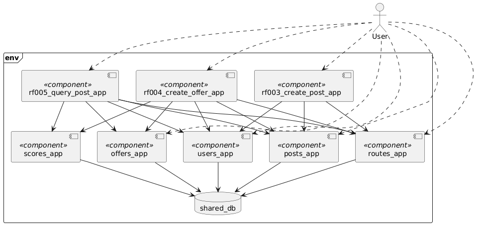

# Functional View

This model presents some of the runtime components defined for the architecture. It does not show every component expected in the system, but rather those required for the project's first iteration.

Each runtime component exposes a REST API. The whole corresponding documentation about each component (app, database, API, deployment, etc) is listed below.

- [Users App](apps/users_app.md)
- [Routes App](apps/routes_app.md)
- [Posts App](apps/posts_app.md)
- [Offers App](apps/offers_app.md)

# New Components (Entrega 2)

The following table documents every **new** component introduced in Entrega 2, per the required documentation format. Legacy components from Entrega 1 (`users_app`, `posts_app`, `offers_app`, `routes_app`) are not modified and are therefore not repeated here, except where their existing responsibilities are relevant to an integration.

| Component | Component Name | Component Code/ID | Type | Responsibility | Design Considerations | Integrations |
|---|---|---|---|---|---|---|
| **RF-003 orchestrator** | `rf003_create_post_app` | `RF003App` | Service | Exposes `POST /rf003/posts`. Orchestrates route resolution (find-or-create) and post creation as a single client-facing operation, fulfilling the "one host, one request" constraint for post creation. | Introduces a synchronous multi-hop call chain (Users → Routes → Posts) behind one request; must handle partial failure to keep data consistent (compensating action or fail-fast design) and must not duplicate business logic already owned by Routes/Posts. Adds latency proportional to the number of downstream calls. | Calls `users_app` (validate bearer token via existing auth endpoint); calls `routes_app` (find route by `flightId`, or create if absent); calls `posts_app` (create post). All calls are synchronous HTTP/REST. |
| **RF-004 orchestrator** | `rf004_create_offer_app` | `RF004App` | Service | Exposes `POST /rf004/posts/{id}/offers`. Orchestrates offer creation, ownership/expiration validation, and score calculation/persistence as a single client-facing operation. | Same multi-hop consistency concern as RF-003; additionally depends on the new `scores_app`, which is explicitly allowed to be unavailable—this orchestrator must degrade gracefully (for example, still create the offer, treat the score as pending) rather than fail the whole request when scoring is down. | Calls `users_app` (auth); calls `posts_app` (validate post exists, not expired, not own post); calls `routes_app` (retrieve `bagCost` for score calculation); calls `offers_app` (create offer); calls `scores_app` (persist calculated score). All calls synchronous HTTP/REST. |
| **RF-005 orchestrator** | `rf005_query_post_app` | `RF005App` | Service | Exposes `GET /rf005/posts/{id}`. Aggregates a post, its route, and its offers (sorted descending by score) into a single response, enforcing that only the post's owner may view it. | Read-heavy aggregation across 5 services in one request; must tolerate `scores_app` being unavailable per-offer (returning `score: null` for that offer) without failing the entire response—this is an explicit resilience requirement, not just a nice-to-have. Highest fan-out of the three orchestrators, so it's the most latency- and failure-sensitive. | Calls `users_app` (auth); calls `posts_app` (fetch post, validate ownership); calls `routes_app` (fetch route details); calls `offers_app` (fetch offers for the post); calls `scores_app` (fetch score per offer, nullable). All calls synchronous HTTP/REST. |
| **Score service** | `scores_app` | `ScoresApp` | Service + Database (owns its own schema) | Owns the Utilidad (Score) entity. Persists a score value per offer so it can be retrieved later even if it changes over time; must not be a calculate-only/stateless component. | New bounded context introduced solely for Entrega 2; its own availability directly affects RF-004 (must still allow offer creation if scoring temporarily fails) and RF-005 (must return `null` per-offer rather than erroring). API and schema design are fully owned by the team since the document does not define them. | Written to by `rf004_create_offer_app` (persist score on offer creation); read by `rf005_query_post_app` (retrieve score per offer). No direct access to any other service's data—reads/writes only its own schema in the shared database. |s
| **Shared database** | `shared_db` | `SharedDb` | Database | Single managed PostgreSQL instance (AWS RDS) hosting all applications' data. Each application's data is logically isolated (per-app schema and DB role/grants)—no cross-app queries or foreign keys, preserving the "each app owns its data" principle despite sharing one physical instance. | Replaces Entrega 1's one-database-per-app model to reduce cloud cost/footprint, as required by the document ("una sola base de datos... que albergará todas las tablas desacopladas"). Isolation between apps' data is enforced at the PostgreSQL level (schema + role grants), not at the network level, since a single RDS instance cannot be split by K8s NetworkPolicy. Introduces a shared operational dependency: if RDS is unavailable, all data-owning apps are affected simultaneously (a trade-off accepted for cost/time reasons). | Read/written by `users_app`, `posts_app`, `offers_app`, `routes_app`, and `scores_app`, each scoped to its own schema via its own database role. Port 5432, PostgreSQL protocol. No orchestrator or client accesses this database directly—always through the owning app's API. |

## Notes on legacy components referenced above

For completeness, here is how the **already-implemented** components are used as integration targets by the new components (they are not modified, and are documented here only to make the "Integrations" column above traceable):

| Component | Component Name | Type | Role in Entrega 2 |
|---|---|---|---|
| Users service | `users_app` | Service | Unmodified. Provides bearer-token authentication (`POST /users/auth`, `GET /users/me`), called by all three orchestrators. |
| Posts service | `posts_app` | Service | Unmodified. Owns post data, called by RF-003 (create), RF-004 (validate), and RF-005 (query). |
| Offers service | `offers_app` | Service | Unmodified. Owns offer data, called by RF-004 (create) and RF-005 (query). |
| Routes service | `routes_app` | Service | Unmodified. Owns route data, called by RF-003 (find-or-create) and RF-004/RF-005 (retrieve route/bagCost details). |