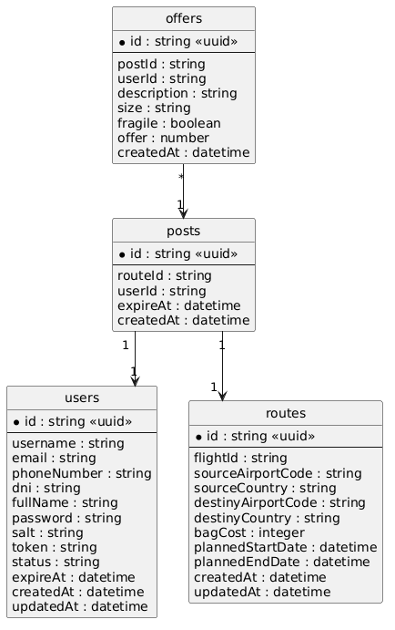

# Information View

# Entity: User

| Field         | Data Type                                   | Description                                                                                                                    |
| ------------- | ------------------------------------------- | ------------------------------------------------------------------------------------------------------------------------------ |
| `id`          | string                                      | User identifier in UUID format.                                                                                                |
| `username`    | string without spaces or special characters | Username.                                                                                                                      |
| `email`       | string in email format                      | User's email address.                                                                                                          |
| `phoneNumber` | optional string                             | Phone number for contact.                                                                                                      |
| `dni`         | optional string                             | User's identification document.                                                                                                |
| `fullName`    | optional string                             | User's full name.                                                                                                              |
| `password`    | string                                      | Encrypted user password.                                                                                                       |
| `salt`        | string                                      | Salt used for password encryption. [Read more](https://auth0.com/blog/adding-salt-to-hashing-a-better-way-to-store-passwords/) |
| `token`       | string                                      | User's current token.                                                                                                          |
| `status`      | string                                      | User status. Only one of these values is valid: **`POR_VERIFICAR`**, **`NO_VERIFICADO`**, **`VERIFICADO`**.                    |
| `expireAt`    | datetime                                    | Expiration date and time of the user's last session (generated token).                                                         |
| `createdAt`   | datetime                                    | Date and time when the user was created.                                                                                       |
| `updatedAt`   | datetime                                    | Date and time when the user was last updated.                                                                                  |

## Entity: Route

| Field                | Data Type | Description                                                                                                                                    |
| -------------------- | --------- | ---------------------------------------------------------------------------------------------------------------------------------------------- |
| `id`                 | string    | Route identifier in UUID format.                                                                                                               |
| `flightId`           | string    | Flight identifier, for example, `AA001`. This field must be unique.                                                                            |
| `sourceAirportCode`  | string    | IATA code of the departure airport. [See IATA airport codes](https://es.wikipedia.org/wiki/Anexo:Aeropuertos_seg%C3%BAn_el_c%C3%B3digo_IATA)   |
| `sourceCountry`      | string    | Country of origin.                                                                                                                             |
| `destinyAirportCode` | string    | IATA code of the destination airport. [See IATA airport codes](https://es.wikipedia.org/wiki/Anexo:Aeropuertos_seg%C3%BAn_el_c%C3%B3digo_IATA) |
| `destinyCountry`     | string    | Destination country.                                                                                                                           |
| `bagCost`            | integer   | Cost of shipping one bag along the route.                                                                                                      |
| `plannedStartDate`   | datetime  | Planned date and time when the route starts.                                                                                                   |
| `plannedEndDate`     | datetime  | Planned date and time when the route ends.                                                                                                     |
| `createdAt`          | datetime  | Date and time when the route was created.                                                                                                      |
| `updatedAt`          | datetime  | Date and time when the route was last updated.                                                                                                 |

## Entity: Post

| Field       | Data Type | Description                                           |
| ----------- | --------- | ----------------------------------------------------- |
| `id`        | string    | Post identifier in UUID format.                       |
| `routeId`   | string    | Identifier of the associated route.                   |
| `userId`    | string    | Identifier of the user who owns the post.             |
| `expireAt`  | datetime  | Latest date and time at which offers can be received. |
| `createdAt` | datetime  | Date and time when the post was created.              |

## Entity: Offer

| Field         | Data Type | Description                                                                                              |
| ------------- | --------- | -------------------------------------------------------------------------------------------------------- |
| `id`          | string    | Offer identifier in UUID format.                                                                         |
| `postId`      | string    | Identifier of the post associated with the offer.                                                        |
| `userId`      | string    | Identifier of the user who submitted the offer.                                                          |
| `description` | string    | Description of no more than 140 characters about the package to be transported.                          |
| `size`        | string    | Subjective description of the package size. Valid values are **`LARGE`**, **`MEDIUM`**, and **`SMALL`**. |
| `fragile`     | boolean   | Indicates whether the package is fragile.                                                                |
| `offer`       | number    | Offer amount in US dollars for transporting the package.                                                 |
| `createdAt`   | datetime  | Date and time when the offer was created.                                                                |
