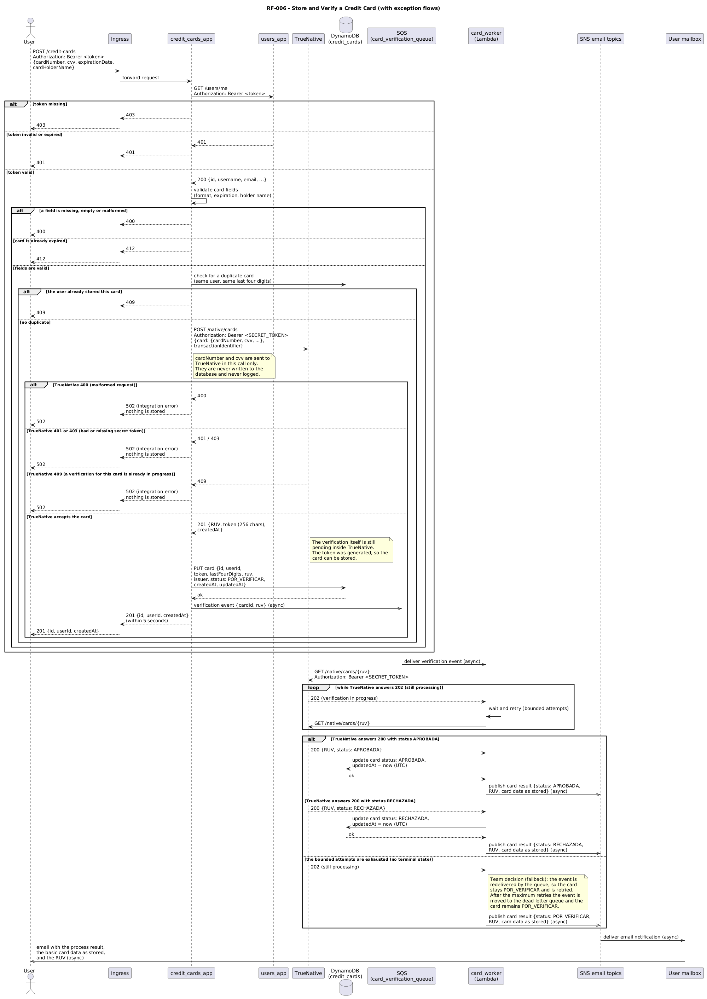

# RF-006 Sequence View

Back to the [documentation home](./README.md). The pattern and trade offs behind this flow are documented in the [Solution Patterns section](./solution-patterns.md) (the RF-006 entry is added by the patterns task).

In the diagram, solid arrows are synchronous interactions and dashed arrows are asynchronous interactions. The flow has two clearly separated phases: a synchronous phase that runs inside the client request and must answer within 5 seconds, and an asynchronous phase that runs after the response, driven by the queue.

## Flow Description

### Synchronous phase (inside the request)

`credit_cards_app` exposes `POST /credit-cards` behind the single entry point. The steps, in order:

1. **Routing**: the Ingress forwards the request to `credit_cards_app`. The user makes one request to one host; the service coordinates the rest.
2. **Auth**: validate the bearer token against `users_app` (`GET /users/me`). This also resolves the card owner.
3. **Validation**: check the request fields (card number format, expiration date, holder name).
4. **Duplicate check**: look up the caller's stored cards in its own DynamoDB table. The same card stored twice by the same user is rejected.
5. **Tokenization at TrueNative**: call `POST /native/cards` with the `card` object (including `cardNumber` and `cvv`) and a unique `transactionIdentifier`, authenticated with the `Authorization: Bearer <SECRET_TOKEN>` header. TrueNative generates the 256 character payment token and returns the RUV.
6. **Persistence**: store the card with `status = POR_VERIFICAR`, together with the payment token, the last four digits, the RUV, the issuer, and the creation and update dates.
7. **Event publish**: send the verification event (card id and RUV) to the SQS queue. This is the only asynchronous hand off of the flow.
8. **Answer**: return `201 {id, userId, createdAt}`. The synchronous path performs only one token validation, one TrueNative call, and one database write, so it completes within the 5 second limit without waiting for the verification (TrueNative commits to up to 30 seconds for it).

### Asynchronous phase (after the response)

The `card_worker` Lambda function is the consumer of the queue:

9. **Event consumption**: the queue delivers the verification event to the worker.
10. **Polling**: the worker polls `GET /native/cards/{ruv}` with the secret token header. A `202` means the verification is still in progress, so the worker waits and retries, up to a bounded number of attempts.
11. **Terminal state**: when TrueNative answers `200`, the worker reads the final status and updates the card in the database with that status and `updatedAt` set to the current UTC date. The update is by card id, so it is idempotent under the at least once delivery of the queue.
12. **Email**: the worker publishes the result to the SNS email topics, which deliver the notification to the user. The email is sent for every outcome and contains the process result, the basic card data as stored in the database, and the RUV generated by TrueNative. The recipient is the owner email that `credit_cards_app` resolved through the users application API (`GET /users/me`) at creation time and carried in the verification event, so the worker never reads the users database.

## Exception Flow Summary

| Stage | Failure | Behavior |
|---|---|---|
| Auth | No token in the request | Answer 403 |
| Auth | Token invalid or expired | Answer 401 (passed through from `users_app`) |
| Validation | A field is missing, empty, or malformed | Answer 400 |
| Validation | The card is already expired | Answer 412 |
| Duplicate check | The user already stored this card | Answer 409 |
| TrueNative registration | 400 (malformed request), 401 or 403 (bad or missing secret token), 409 (a verification for this card is already in progress) | Nothing is stored; answer 502 (integration error). If TrueNative cannot generate the token, the card is not stored and the user sees the error, per the acceptance criteria |
| TrueNative verification | The card is rejected | The card is stored as `RECHAZADA` with a refreshed `updatedAt`, and the owner is notified by email |
| TrueNative verification | No terminal state within the bounded attempts | Team decision, see below |

## Team decision: fallback when TrueNative never reaches a terminal state

The project document does not specify what happens if TrueNative keeps answering 202 beyond the polling budget. The team decision, shown in the diagram as the last branch of the polling loop, is:

- The worker gives up on that invocation, and the queue redelivers the event (at least once delivery), so the card stays `POR_VERIFICAR` and the polling is retried in a later invocation.
- After the maximum number of retries, the event is moved to the dead letter queue and the card remains `POR_VERIFICAR`. The owner is still notified by email with the `POR_VERIFICAR` status and the RUV, so the user is never left without the mandatory notification.
- A card in `POR_VERIFICAR` is simply a card whose verification is pending; no other part of the system depends on it being resolved, so the fallback does not block any other flow.

## Key rules

- **Synchronous and asynchronous are visually distinguished**: solid arrows are request response interactions (HTTP/REST and DynamoDB), dashed arrows are event driven interactions (SQS delivery, SNS publish, and email delivery).
- **Raw card data is never persisted**: `cardNumber` and `cvv` are used only in the `POST /native/cards` call to TrueNative. The database stores only the last four digits, the issuer, the payment token, the RUV, the status, and the dates.
- **Status names are used exactly as specified**: `POR_VERIFICAR`, `APROBADA`, and `RECHAZADA`, without translation.
- **No background work in the web component**: `credit_cards_app` never polls or waits. The polling loop lives in `card_worker`, a separate deployable, so the restriction that forbids asyncio, threads, and background tasks in the web components is respected.
- **The email is mandatory for every outcome**: approved, rejected, and the pending fallback all produce a notification with the result, the basic card data as stored, and the RUV.
