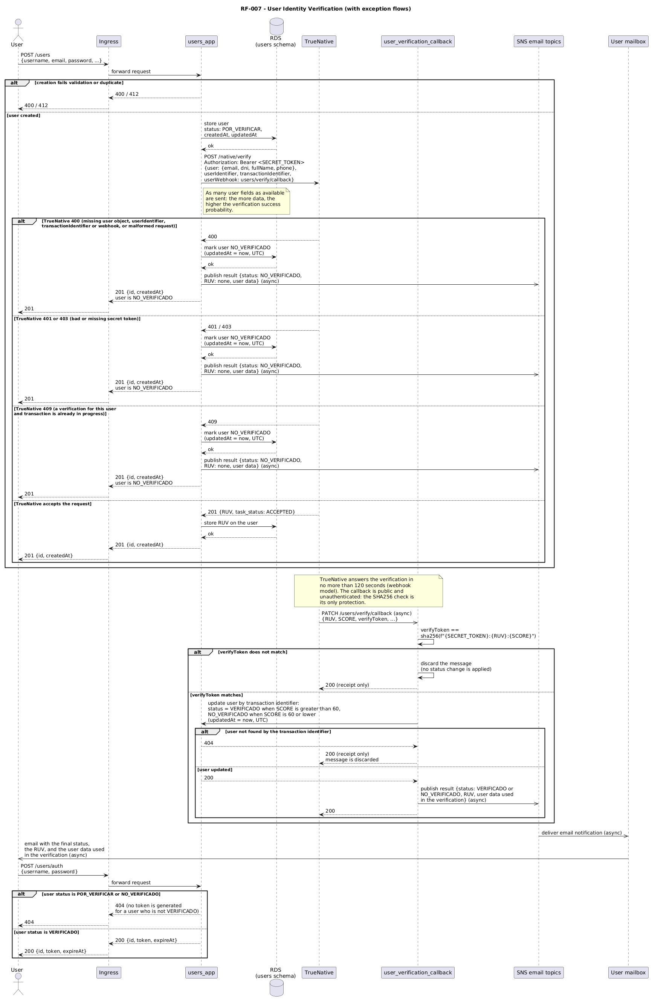

# RF-007 Sequence View

Back to the [documentation home](./README.md). The pattern and trade offs behind this flow are documented in the [Solution Patterns section](./solution-patterns.md) (the RF-007 entry is added by the patterns task).

In the diagram, solid arrows are synchronous interactions and dashed arrows are asynchronous interactions. The flow has three clearly separated parts: the user creation (synchronous, inside the request), the identity verification callback (asynchronous, initiated by TrueNative), and the token block that applies while the user is not verified (a regular authentication request).

## Flow Description

### User creation (synchronous phase)

The requirement is triggered when a user is created, so the flow starts at `POST /users` on `users_app`, behind the single entry point:

1. **Routing**: the Ingress forwards the request to `users_app`.
2. **Persistence**: the user is stored with `status = POR_VERIFICAR` and with the creation and update dates in UTC. A user in `POR_VERIFICAR` cannot access the system, as the acceptance criteria require.
3. **Verification request**: `users_app` calls TrueNative `POST /native/verify` with the `user` object (as many fields as available: `email`, `dni`, `fullName`, and `phone`, since the more data is sent the higher the success probability), a unique `transactionIdentifier`, the `userIdentifier`, and the `userWebhook` (the public callback path). The request is authenticated with the `Authorization: Bearer <SECRET_TOKEN>` header.
4. **RUV storage**: when TrueNative answers `201` with `task_status: ACCEPTED`, the returned RUV is stored on the user record. The RUV and the `transactionIdentifier` are the correlation keys that the callback will use later.
5. **Answer**: the creation answers `201` with `{id, createdAt}`. The user exists and is waiting for the verification result.

### Identity verification callback (asynchronous phase)

TrueNative commits to deliver the result in no more than 120 seconds through the webhook:

6. **Callback delivery**: TrueNative sends a `PATCH` to the public callback path with the RUV, the score, and the `verifyToken`. The callback is public by design (TrueNative has no authorization mechanism for callbacks), so the callback component (`user_verification_callback`, a separate deployable that keeps `users_app` free of an unauthenticated route) is the only one that sees it.
7. **Integrity check**: the callback verifies that `verifyToken` equals `sha256(f"{SECRET_TOKEN}:{RUV}:{SCORE}")`. This SHA256 over the secret token, the RUV, and the score is the only protection of the public endpoint: a message whose token does not match is discarded and no status change is applied.
8. **Status update**: when the check passes, the callback updates the user through the `users_app` API (never through the database, preserving the data ownership rule), using the `transactionIdentifier` to resolve the user. The score threshold is applied as decided by the team (see the next section): `VERIFICADO` when the score is greater than 60, and `NO_VERIFICADO` when the score is 60 or lower. The `updatedAt` field is refreshed to the current UTC date on the status change.
9. **Answer to TrueNative**: the callback answers `200` on receipt, as the TrueNative contract requires.
10. **Email**: the callback publishes the result to the SNS email topics, which deliver the notification to the user. The email is sent for both outcomes and contains the final status, the RUV generated by TrueNative, and the user data used in the verification process.

### Token block (the consequence of the status)

While the user is not `VERIFICADO`, the platform cannot be used:

11. **Blocked login**: a `POST /users/auth` by a user in `POR_VERIFICAR` or `NO_VERIFICADO` is rejected, because `users_app` no longer generates tokens for users who are not verified. The existing authentication behavior answers `404` for credentials it does not accept, and that is the status a blocked user sees: no token is ever issued, so the user cannot call any service that requires a bearer token.
12. **Allowed login**: when the status is `VERIFICADO`, the same request answers `200` with `{id, token, expireAt}` and the user can use the platform. The token verification paths of `users_app` also reject tokens that belong to users who are no longer `VERIFICADO`, so a blocked user cannot keep working with a previously issued token.

## Exception Flow Summary

| Stage | Failure | Behavior |
|---|---|---|
| User creation | Validation error or duplicate | Answer 400 or 412, no verification request is made |
| Verification request | TrueNative 400 (missing `user` object, `userIdentifier`, `transactionIdentifier`, or webhook, or malformed request) | The user is stored as `NO_VERIFICADO` with a refreshed `updatedAt`, the user is notified by email, and the creation still answers 201 so the user exists and can be fixed later |
| Verification request | TrueNative 401 or 403 (bad or missing secret token) | Same behavior as the 400 case: the user is `NO_VERIFICADO` and is notified by email |
| Verification request | TrueNative 409 (a verification for this user and transaction is already in progress) | Same behavior: the user is `NO_VERIFICADO` and is notified by email |
| Callback | `verifyToken` does not match the SHA256 | The message is discarded, no status change is applied, and the callback still answers 200 to TrueNative |
| Callback | The user cannot be resolved by the transaction identifier | The message is discarded, no status change is applied, and the callback still answers 200 |
| Login | The user is `POR_VERIFICAR` or `NO_VERIFICADO` | No token is generated; the authentication is rejected and the user cannot enter the platform |

## Team decision: the score threshold at exactly 60

The project document conflicts at a score of exactly 60: the RF-007 acceptance criteria say that a score equal to or greater than 60 means the user was verified, while the TrueNative callback section says that a score lower than or equal to 60 responds `NO_VERIFICADO` and `VERIFICADO` only when the score exceeds the threshold of 60.

The team decision (recorded with @svitery) is to follow the TrueNative callback condition: **`VERIFICADO` when the score is greater than 60, and `NO_VERIFICADO` when the score is 60 or lower**. The rationale is practical: the callback is the component that maps the score to a status, and TrueNative already documents that a score of 60 or lower is a `NO_VERIFICADO` outcome, so adapting the platform to the provider behavior is easier to implement and to test than the opposite direction. The threshold and its two resulting states are stated explicitly in the diagram, and this section documents the decision for the review.

## Key rules

- **Synchronous and asynchronous are visually distinguished**: solid arrows are request response interactions (HTTP/REST and the database), dashed arrows are event driven interactions (the TrueNative webhook delivery, the SNS publish, and the email delivery).
- **The callback is public and protected by the SHA256 check**: the integrity check `sha256(f"{SECRET_TOKEN}:{RUV}:{SCORE}")` is the only authorization of the endpoint, and a message that fails it is discarded without applying any change.
- **Status names are used exactly as specified**: `POR_VERIFICAR`, `VERIFICADO`, and `NO_VERIFICADO`, without translation.
- **The email is mandatory for every outcome**: both `VERIFICADO` and `NO_VERIFICADO` produce a notification with the final status, the RUV, and the user data used in the verification, including the outcomes that come from the exception flows of the verification request.
- **No background work in the web components**: `users_app` never waits for the verification (the request is fire and forget at registration time, and the result arrives through the separate callback component), so the restriction that forbids asyncio, threads, and background tasks in the users web component is respected.
- **Data ownership is preserved**: the callback updates the user through the `users_app` API, never through the database.
