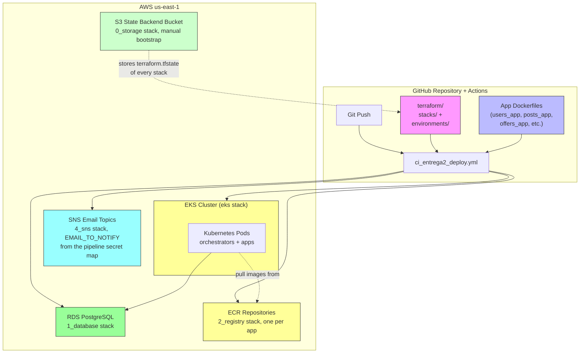

# Terraform Cloud Infrastructure

## Overview

This project uses Terraform to provision cloud infrastructure on AWS (Amazon Web Services) in the `us-east-1` region. The infrastructure is organized into the stacks under `terraform/stacks/`: `0_storage`, `1_database`, `2_registry`, `eks`, and `4_sns`. The active deployment order is the one declared in `config.yaml` `tf_stacks`: `1_database` → `2_registry` → `eks` → `4_sns` (destroy runs in reverse order).

The `0_storage` stack is commented out in `tf_stacks` because the S3 bucket it creates must exist **before any stack can initialize its S3 state backend**: a stack cannot store its state in a bucket that the same stack is supposed to create. For that reason it is provisioned manually, once, with the custom automation scripts in `scripts/terraform_scripts/` (for example `0_bootstrap_state_bucket.sh`, which creates the bucket directly with the AWS CLI and then the rest of the flow uses it as backend). This bootstrap is only possible in `dev` environments with those custom automation scripts; in the student evaluation workflow ("Entrega 2 Deploy") the state backend bucket already exists in the account, so the pipeline simply runs `1_init_all.sh`, `2_plan_all.sh`, and `3_apply_reviewed.sh` over the active stacks.

The deployment pipeline (`ci_entrega2_deploy.yml`) orchestrates the following steps:

1. Terraform applies each stack in `tf_stacks` order (`1_database` → `2_registry` → `eks` → `4_sns`).
2. Docker images are built and pushed to Amazon ECR repositories.
3. Kubernetes manifests are applied to the EKS cluster.

## Infrastructure Architecture



## Stack Decomposition

The project follows a five-stack decomposition model:

| Order | Stack | Components | Purpose |
|-------|-------|-----------|---------|
| 0 (manual) | **0_storage** | S3 bucket used as the Terraform state backend for all stacks (versioning, public access block, default encryption) | Must exist before any stack can `terraform init` with the S3 backend. Provisioned once with the bootstrap script, not part of the pipeline order. |
| 1 | **1_database** | RDS PostgreSQL instance, Secrets Manager secret (DB credentials), per-app schema and role isolation (`users`, `posts`, `offers`, `routes`, `scores`), `create_app_tables` variable that creates the shared app tables | Provisions the shared database layer with per-app schema/role isolation. |
| 2 | **2_registry** | 8 ECR repositories (one per app and orchestrator) with tag retention rules | Provides the image registry for all application workloads. |
| 3 | **eks** | EKS cluster, managed node group, IAM roles (cluster, nodes, pod identity), OIDC provider for IRSA | Provides the container orchestration platform for application workloads. |
| 4 | **4_sns** | Two SNS topics (card verification and user verification) with one email subscription per topic, endpoint read from the `EMAIL_TO_NOTIFY` key of the `secrets-pipeline-native-map` secret | Provisions the email notification mechanism of RF-006 and RF-007 without hardcoding the address. |

The helper scripts in `scripts/terraform_scripts/` automate the flow over all active stacks: `0_bootstrap_state_bucket.sh` (creates the state backend bucket, manual), `1_init_all.sh`, `2_plan_all.sh`, `3_apply_reviewed.sh`, and `zz_destroy_all.sh` (reverse order).

## Stack README Files

Each stack includes a detailed README describing its components, variables, outputs, and relationships. These READMEs are auto-copied into `docs/terraform/` during the GitHub Pages deployment process (see `.github/workflows/pages.yml`).

- [0_storage Stack README](../terraform/stacks/0_storage/README.md)
- [1_database Stack README](../terraform/stacks/1_database/README.md)
- [2_registry Stack README](../terraform/stacks/2_registry/README.md)
- [eks Stack README](../terraform/stacks/eks/README.md)
- [4_sns Stack README](../terraform/stacks/4_sns/README.md)

## Local Deployment (Development Testing)

This section describes how to deploy the infrastructure locally for development and testing purposes. The local deployment uses the helper scripts in `scripts/terraform_scripts/`, which run the same init, plan, and apply flow over every active stack.

### Prerequisites

- Terraform 1.10.0 or newer installed
- AWS CLI configured (for any AWS operations, for example `kubectl` configuration and the state backend bootstrap)
- A valid `aws` credential profile or environment variables (`AWS_ACCESS_KEY_ID`, `AWS_SECRET_ACCESS_KEY`)

### Step 1: Bootstrap the state backend bucket (once, manual)

```bash
# From repo root; creates the S3 bucket used as the Terraform state backend
# for all stacks. Must exist before any `terraform init` with the S3 backend.
./scripts/terraform_scripts/0_bootstrap_state_bucket.sh
```

This step is only possible in `dev` environments with these custom automation scripts. In the student evaluation workflow ("Entrega 2 Deploy") the bucket already exists in the account, so this step is skipped.

### Step 2: Init, plan, and apply all active stacks

```bash
# From repo root, in order:
./scripts/terraform_scripts/1_init_all.sh
./scripts/terraform_scripts/2_plan_all.sh
./scripts/terraform_scripts/3_apply_reviewed.sh
```

The scripts iterate over the stacks declared in `config.yaml` `tf_stacks` (`1_database`, `2_registry`, `eks`, `4_sns`), using the `backend.tfvars` and `terraform.tfvars` files under `terraform/environments/<environment>/<stack>/`. The apply script pauses for manual review of each plan before applying.

### Step 3: Destroy (reverse order)

```bash
# From repo root; destroys the stacks in reverse tf_stacks order
./scripts/terraform_scripts/zz_destroy_all.sh
```

### Verification Steps

After all three stacks are deployed:

```bash
# Verify VPC resources
aws ec2 describe-vpcs --region us-east-1 \
  --filters "Name=tag:Name,Values=shared-suitcase-vpc"

# Verify RDS instance
aws rds describe-db-instances --db-instance-identifier \
  shared-suitcase-postgres --region us-east-1

# List ECR repositories
aws ecr describe-repositories --region us-east-1

# Configure kubectl for the EKS cluster
aws eks update-kubeconfig --name shared-suitcase-cluster --region us-east-1

# Verify EKS cluster connectivity
kubectl get nodes

# List the SNS email topics
aws sns list-topics --region us-east-1 \
  --query 'Topics[?starts_with(TopicName, `grupo33-`)].TopicName'

# List the email subscriptions of a topic
aws sns list-subscriptions-by-topic \
  --topic-arn <card-verification-topic-arn> --region us-east-1
```

## Stack Deployment Order

The stacks are deployed in the order declared in `config.yaml` `tf_stacks`:

1. **1_database**: shared RDS instance, Secrets Manager secret, and per-app schema/role isolation (no upstream stack dependencies)
2. **2_registry**: ECR repositories (no upstream stack dependencies)
3. **eks**: EKS cluster and node group (reads the RDS endpoint and secret ARN from `1_database`, and the ECR repository URIs from `2_registry`)
4. **4_sns**: SNS email topics and email subscriptions (reads the `EMAIL_TO_NOTIFY` key from the `secrets-pipeline-native-map` secret that the deploy pipeline populates before the apply; for a local plan on a fresh account, create the secret once beforehand with the AWS CLI because only the pipeline creates it, see the `4_sns` stack README; no upstream stack dependencies)

The `0_storage` stack (state backend bucket) is always deployed before any of the above, manually, because it cannot be part of the order: the bucket must exist before any stack can initialize its S3 backend.

## Destroy Order

Destroy the stacks in reverse `tf_stacks` order (the `zz_destroy_all.sh` script automates this):

```bash
# 1. Destroy 4_sns (SNS topics and email subscriptions)
cd terraform/stacks/4_sns && terraform destroy \
  -var-file=../../environments/student1/4_sns/terraform.tfvars

# 2. Destroy eks (EKS cluster, node group)
cd ../eks && terraform destroy \
  -var-file=../../environments/student1/eks/terraform.tfvars

# 3. Destroy 2_registry (ECR repositories)
cd ../2_registry && terraform destroy \
  -var-file=../../environments/student1/2_registry/terraform.tfvars

# 4. Destroy 1_database (RDS instance, Secrets Manager secret)
cd ../1_database && terraform destroy \
  -var-file=../../environments/student1/1_database/terraform.tfvars
```

## Post-Deployment: Kubernetes Workloads

After Terraform creates the EKS cluster and ECR repositories, deploy application workloads using kubectl:

### Push Application Images to ECR

For each application in `config.yaml`:

```bash
# Authenticate Docker to ECR
aws ecr get-login-password --region us-east-1 | docker login \
  --username AWS <ecr-repository-uri>

# Build and push the image
cd users_app
docker build -t users-app:v0.0.0 .
docker tag users-app:v0.0.0 <ecr-repository-uri>/users-app:v0.0.0
docker push <ecr-repository-uri>/users-app:v0.0.0
cd ..
```

### Deploy Kubernetes Manifests

After all images are pushed to ECR, update the k8s manifests with the ECR image URIs and RDS endpoint, then apply:

```bash
kubectl apply -f k8s/

# Verify pods are running
kubectl get pods
kubectl get services
kubectl get ingress
```

### Per-App Schema Initialization

The `1_database` stack creates the shared app tables in the RDS database when the `create_app_tables` variable is `true`. The default table names are `["users", "routes", "posts", "offers", "scores"]`, and each table is owned by its app's schema and role (for example, the `users` table lives in the `users` schema and is writable only by the `users_user` role). No separate SSM parameter or manual SQL script is needed: the schema creation happens as part of the stack apply.

## Terraform State Backend Configuration

### S3 Remote Backend (all stacks)

Every stack stores its state in the shared S3 bucket created by the `0_storage` bootstrap, with one key per stack. The backend is configured in the `backend.tfvars` files under:

```
terraform/environments/<environment>/0_storage/backend.tfvars
terraform/environments/<environment>/1_database/backend.tfvars
terraform/environments/<environment>/2_registry/backend.tfvars
terraform/environments/<environment>/eks/backend.tfvars
```

Example for the `1_database` stack:

```hcl
bucket = "terraform-dann-pe-trujillo-prod"
key    = "database/terraform.tfstate"
region = "us-east-1"
```

The stack key follows the same convention for every stack (for example, `storage/terraform.tfstate`, `registry/terraform.tfstate`, `eks/terraform.tfstate`).

## Remote State Configuration

The `eks` stack reads outputs from the upstream stacks via Terraform remote state. The state file keys are configured as variables:

| Stack | Reads From | Variable | Default Key |
|-------|-----------|----------|-------------|
| eks | 1_database | `database_state_path` | `database/terraform.tfstate` |
| eks | 2_registry | `registry_state_path` | `registry/terraform.tfstate` |

For multi-environment support, each environment (for example, `student1`, `dev`) has its own set of backend and tfvars files under `terraform/environments/<environment>/`.

## Security Considerations

- **No credentials in source code**: AWS credentials (AWS_ACCESS_KEY_ID, AWS_SECRET_ACCESS_KEY, DB_USERNAME, DB_PASSWORD) are stored exclusively as GitHub Environment secrets or in local `.tfvars` files excluded from version control.
- **Least privilege IAM roles**: Each stack defines only the minimum IAM policies required for its resources. The `eks` stack includes Pod Identity (IRSA) so that k8s workloads can access Secrets Manager without long-lived credentials.
- **Per-app credential isolation**: Each application has its own Secrets Manager secret with a unique generated password, preventing cross-app credential sharing.
- **RDS deletion protection is disabled**: This simplifies local testing and stack destroy workflows, but should be enabled in production environments.
