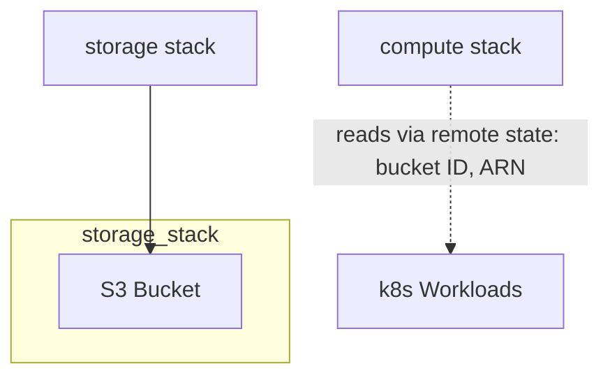

# Storage Stack

## Overview

The **storage** stack provisions a single shared S3 bucket used as object storage for all applications and orchestrators in the project. It serves as the foundation for storing static assets, uploads, backups, and any file-based data that does not belong to the relational database.

## Components

| Resource | Description |
|---|---|
| **S3 Bucket** | A single versioned S3 bucket with encryption enabled by default. All applications share this bucket; each app writes to its own prefix/key pattern (for example, `users_app/`, `posts_app/`). Force-destroy is disabled in production; can be enabled for dev/test environments. |

### Versioning and Security

- **Versioning**: Enabled on the bucket to protect against accidental deletions and allow rollback of file changes.
- **Force Destroy**: Disabled by default (set to `true` only in dev/test environments via variable override).
- **Tags**: All resources are tagged with `Project=grupo33`, `Stack=storage`, and `Owner=<var.owner>` for cost tracking and identification.

## Cross-Stack Relationships



- The **storage stack** outputs `bucket_id` and `bucket_arn`.
- The **compute stack** reads these outputs via remote state to inject into k8s manifests as environment variables (for example, `AWS_S3_BUCKET_ID`, `AWS_S3_BUCKET_ARN`) so that EKS workloads can reference the bucket in their S3 client configurations.

## Variables

| Variable | Type | Default | Sensitive | Description |
|---|---|---|---|---|
| `aws_region` | `string` | `"us-east-1"` | No | AWS region. |
| `environment` | `string` | — | No | Environment name (for example, `student1`, `tutor`). Required, no default. |
| `bucket_name` | `string` | — | No | Globally unique S3 bucket name for this environment. Must be unique across AWS accounts. |
| `owner` | `string` | — | No | Owner of the resources (generally the user or team name). |

## Outputs

| Output | Type | Description | Consumed By |
|---|---|---|---|
| `bucket_id` | `string` | S3 bucket name/ID | compute stack → k8s manifests |
| `bucket_arn` | `string` | S3 bucket ARN (for example, `arn:aws:s3:::shared-suitcase-storage`) | compute stack → k8s manifests |

## Deployment Order

Deploy **first** among the application stacks, since other stacks may reference the bucket.

```bash
# From repo root, in order:
cd terraform/stacks/storage && terraform init -backend-config=backend.tfvars
terraform plan -var="environment=<env>" -var="bucket_name=<unique-name>" -var="owner=<owner>"
terraform apply
```

## Destroy Order

Destroyed **last** among the application stacks (after compute and data have been removed to avoid dangling references).

## Manual Verification

```bash
# Initialize and deploy
cd terraform/stacks/storage
terraform init -backend-config=backend.tfvars
terraform plan -var="environment=student1" -var="bucket_name=my-unique-bucket-name" -var="owner=pe.trujillo"
terraform apply

# Verify bucket exists and versioning is enabled
aws s3api get-bucket-versioning --bucket <bucket-id> --region us-east-1
aws s3api head-bucket --bucket <bucket-id> --region us-east-1
```

## Terraform State Backend

Uses **S3 remote backend** by default. Configure in:

```
terraform/environments/<environment>/storage/backend.tfvars
```

Example `backend.tfvars`:

```hcl
bucket         = "my-terraform-state-bucket"
key            = "storage/terraform.tfstate"
region         = "us-east-1"
dynamodb_table = "terraform-locks"
```

## Important Notes for EKS Workloads

Applications deployed to EKS must:
1. Use the bucket name from `bucket_id` output in their S3 client configuration.
2. Reference the bucket ARN from `bucket_arn` output when defining IAM policies.
3. Have their Pod Identity bound to an IAM role that grants `s3:GetObject`, `s3:PutObject`, and related permissions on the specific bucket prefix they own.
