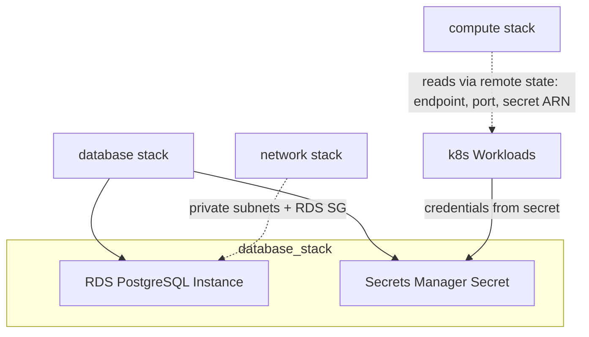

# Database Stack

## Overview

The **database** stack provisions the shared PostgreSQL database (AWS RDS) that all applications share, along with Secrets Manager credentials for per-app authentication. It replaces Entrega 1's one-database-per-app local model with a single cloud instance where each application owns its own schema with dedicated role grants.

## Components

| Resource | Description |
|---|---|
| **RDS PostgreSQL Instance** | Single managed PostgreSQL database instance. One master user (`admin`) with per-app schema/role isolation at the database level. Backup retention configured via AWS defaults. Public access configurable (disabled by default in production). |
| **Secrets Manager Secret** | Stores DB credentials (username, password, host, port, dbname, engine) as JSON. Accessible by EKS workloads via Pod Identity / IRSA. |

### Per-App Schema Isolation

Each app gets its own PostgreSQL schema and a dedicated login role:

| App | Schema Name | Role Name |
|---|---|---|
| users_app | `users` | `users_user` |
| posts_app | `posts` | `posts_user` |
| offers_app | `offers` | `offers_user` |
| routes_app | `routes` | `routes_user` |
| scores_app | `scores` | `scores_user` |

The `create_app_tables` variable controls whether the shared app tables are created in the RDS database. Default table names: `["users", "routes", "posts", "offers", "scores"]`.

## Cross-Stack Relationships



- The **network stack** provides `private_subnet_ids` and RDS security group (via remote state).
- The **deploy pipeline** renders the `rds_address` output into the k8s app secrets via envsubst (the port and the database name are fixed values hardcoded in `k8s_entrega2/00-secrets.yml`, because their values equal the `DB_PORT`/`DB_NAME` environment secrets and cannot pass through the pipeline's combined `tf_outputs`); the `secrets_manager_secret_name` output is consumed by the local AWS deploy script (`scripts/terraform_scripts/deploy-k8s-to-eks.sh`).

## Variables

| Variable | Type | Default | Sensitive | Description |
|---|---|---|---|---|
| `aws_region` | `string` | `"us-east-1"` | No | AWS region. |
| `db_allocated_storage_gib` | `number` | — | No | Initial storage in GB for the database. |
| `db_name` | `string` | — | No | Name of the RDS database. |
| `db_username` | `string` | — | Yes | Admin username for the RDS database. |
| `db_password` | `string` | — | Yes | Admin password for the RDS database. Override with secret in production. |
| `db_publicly_accessible` | `bool` | — | No | Whether the DB should be publicly accessible. |
| `sg_ingress_cidr_blocks` | `list(string)` | — | No | List of CIDR blocks allowed to access the RDS instance. |
| `secret_name` | `string` | — | Yes | Name of the secret in AWS Secrets Manager. |
| `create_app_tables` | `bool` | `false` | No | Whether to create shared app tables in the RDS database. |
| `app_table_names` | `list(string)` | `["users", "routes", "posts", "offers", "scores"]` | No | Table names to create for apps in the shared DB. |
| `owner` | `string` | — | No | Owner of the resources (typically user or team name). |

## Outputs

| Output | Type | Description | Consumed By |
|---|---|---|---|
| `rds_address` | `string` | RDS endpoint (for example, `shared-suitcase-postgres.xxxxxx.us-east-1.rds.amazonaws.com`) | k8s app secrets (envsubst, `k8s_entrega2/00-secrets.yml`) |
| `rds_engine` | `string` | DB engine type (for example, `postgres`) | documentation |
| `secrets_manager_secret_name` | `string` | Name of the AWS Secrets Manager secret (usable as `secret-id` for the aws cli) | local AWS deploy script |
| `create_app_tables` | `bool` | Whether app tables were created in the shared DB | documentation |
| `app_table_names` | `list(string)` | Names of app tables created in the shared DB | documentation |

`rds_port`, `rds_db_name` and the secret ARN are deliberately not
exposed: the port (`5432`) and the database name (`shared_db`) equal the
`DB_PORT` and `DB_NAME` environment secrets, and the ARN embeds the AWS
account id — the deploy pipeline merges every stack output into a single
JSON that GitHub Actions silently discards when it contains the value of
any environment secret (the whole `tf_outputs` job output was lost this
way). The port and the name are hardcoded in the k8s manifest instead,
and the ARN remains available via `aws secretsmanager describe-secret`.

## Deployment Order

Deploy **after** the network stack (depends on its outputs via remote state). Deploy **before** the compute and registry stacks.

```bash
# From repo root, in order:
cd terraform/stacks/network && terraform apply
cd ../database && terraform init -reconfigure
terraform plan \
  -var="aws_region=us-east-1" \
  -var="db_allocated_storage_gib=20" \
  -var="db_name=shared_db" \
  -var="db_username=admin" \
  -var="db_password=<your-secure-password>" \
  -var="db_publicly_accessible=false" \
  -var="sg_ingress_cidr_blocks=[\"10.0.0.0/16\"]" \
  -var="secret_name=shared-suitcase/db-credentials" \
  -var="create_app_tables=true" \
  -var="app_table_names=[\"users\",\"routes\",\"posts\",\"offers\", \"scores\"]" \
  -var="owner=pe.trujillo@uniandes.edu.co"
terraform apply
```

## Destroy Order

Destroyed **before** the compute stack (RDS must be deleted before its dependent networks).

## Manual Verification

```bash
# Initialize and deploy
cd terraform/stacks/database
terraform init -reconfigure
terraform plan \
  -var="aws_region=us-east-1" \
  -var="db_allocated_storage_gib=20" \
  -var="db_name=shared_db" \
  -var="db_username=admin" \
  -var="db_password=<your-secure-password>" \
  -var="secret_name=shared-suitcase/db-credentials" \
  -var="owner=pe.trujillo@uniandes.edu.co"
terraform apply

# Verify RDS instance exists
aws rds describe-db-instances --region us-east-1 \
  --db-instance-identifier shared-suitcase-postgres \
  --query 'DBInstances[0].[DBInstanceIdentifier,Engine,DBInstanceClass,Endpoint.Address]'

# Verify secret
aws secretsmanager get-secret-value --secret-id shared-suitcase/db-credentials --region us-east-1 \
  --query 'SecretString' --output text | jq .
```

## Terraform State Backend

Uses **local backend** by default (`path = terraform.tfstate`). For CI/CD, configure S3 remote in:

```
terraform/environments/<environment>/data/backend.tfvars
```

Example `backend.tfvars`:

```hcl
bucket         = "my-terraform-state-bucket"
key            = "data/terraform.tfstate"
region         = "us-east-1"
dynamodb_table = "terraform-locks"
```

## Important Notes for EKS Workloads

Applications deployed to EKS must:
1. Use the RDS endpoint from `rds_address` output.
2. Configure their connection strings using per-app schema/role names (for example, `postgresql://users_user:<password>@<endpoint>:5432/shared_db/users`).
3. Have their Pod Identity bound to the secret ARN for credential retrieval instead of hardcoding passwords.


## `terraform/modules/rds/`  optional table creation

| File | Purpose |
|------|---------|
| `schema.sql` | DDL for the four shared tables, mirrored 1:1 from the apps' SQLAlchemy models. |
| `init_schema.sh.tpl` | Template rendered with `templatefile`; produces the `psql` command executed against the instance. |
| `main.tf` | New `null_resource.init_app_tables` (count = `create_app_tables ? 1 : 0`) with a `local-exec` provisioner that runs the rendered script after the instance is created. |
| `variables.tf` | New `create_app_tables` (bool, default `false`) and `app_table_names` (list, informational). |
| `outputs.tf` | New `create_app_tables` and `app_table_names` outputs. |
| `data.tf` | VPC/subnet discovery now supports overrides (see §4). |

The four tables and their source of truth:

| Table | App | ORM model |
|-------|-----|-----------|
| `users` | `users_app` | `users_app/src/adapters/database/models.py` → `UserModel` |
| `routes` | `routes_app` | `routes_app/src/adapters/database/models.py` → `SQLAlchemyRouteModel` |
| `posts` | `posts_app` | `posts_app/src/adapters/database/models.py` → `Publication` |
| `offers` | `offers_app` | `offers_app/src/adapters/database/models.py` → `OfferModel` (+ `packagesize` enum from `domain/models/offer.py`) |

