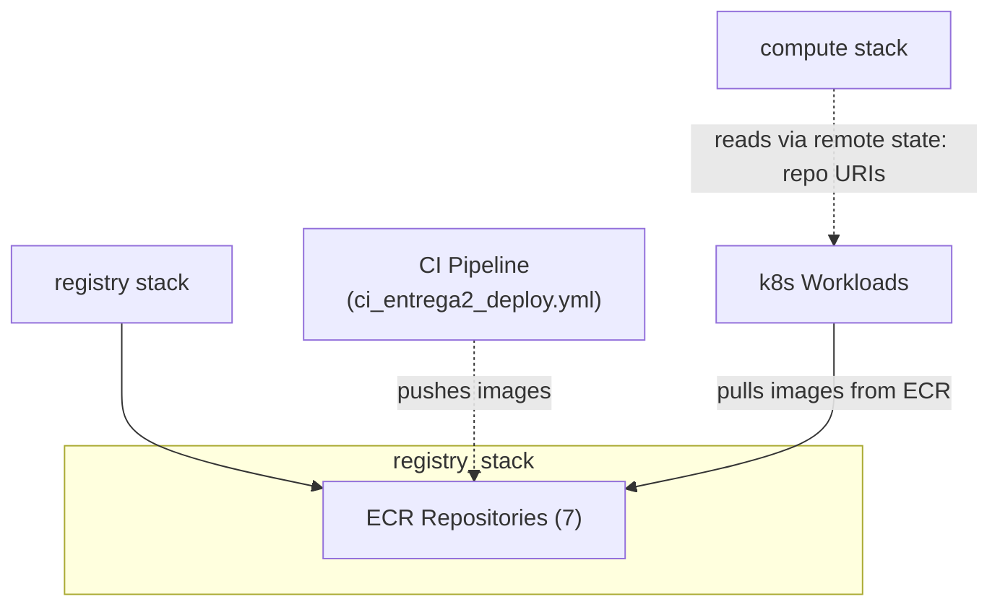

# Registry Stack

## Overview

The **registry** stack provisions Amazon ECR (Elastic Container Registry) repositories for all Docker images used by the applications and orchestrators. Each app gets its own dedicated repository where CI/CD pipelines build, push, and manage container images.

## Components

| Resource | Description |
|---|---|
| **ECR Repositories (7 total)** | Dedicated ECR repos for: `users`, `posts`, `scores`, `routes`, `offers`, `rf003`, `rf004`, `rf005`. Each repository stores the Docker image built from the corresponding app folder (`config.yaml` → `apps:` section). Repository cleanup rules retain only the most recent tags, controlled by `keep_tags_number`. |

### Per-App Repositories

| App (from `config.yaml`) | ECR Repo Name |
|---|---|
| users_app | `users` |
| posts_app | `posts` |
| offers_app | `offers` |
| routes_app | `routes` |
| scores_app | `scores` |
| rf003_create_post_app | `rf003` |
| rf004_create_offer_app | `rf004` |
| rf005_query_post_app | `rf005` |

The stack uses the `../../modules/repository` module to provision each ECR repository with tag-retention rules.

## Cross-Stack Relationships



- The **registry stack** outputs the ECR repository names/URIs.
- The **CI pipeline** (`ci_entrega2_deploy.yml`) reads `config.yaml` → `apps:` to determine which images to build and push to their respective ECR repositories.
- The **compute stack** reads these URIs via remote state to inject into k8s manifests as image references (for example, `123456789.dkr.ecr.us-east-1.amazonaws.com/users:v0.0.0`).

## Variables

| Variable | Type | Default | Sensitive | Description |
|---|---|---|---|---|
| `region` | `string` | — | No | AWS region (required). |
| `owner` | `string` | — | No | Owner tag for resources (required). |
| `keep_tags_number` | `number` | — | No | Number of most recent tags to retain per repository. Required, no default. |
| `users_repository_name` | `string` | — | No | ECR repo name for users_app. |
| `posts_repository_name` | `string` | — | No | ECR repo name for posts_app. |
| `offers_repository_name` | `string` | — | No | ECR repo name for offers_app. |
| `routes_repository_name` | `string` | — | No | ECR repo name for routes_app. |
| `scores_repository_name` | `string` | — | No | ECR repo name for scores_app. |
| `rf003_repository_name` | `string` | — | No | ECR repo name for rf003_create_post_app. |
| `rf004_repository_name` | `string` | — | No | ECR repo name for rf004_create_offer_app. |
| `rf005_repository_name` | `string` | — | No | ECR repo name for rf005_query_post_app. |

## Outputs

| Output | Type | Description | Consumed By |
|---|---|---|---|
| (via modules) | `string` | ECR repository URIs for each app | compute stack → k8s manifests, CI pipeline |

*Note: The registry stack uses module outputs from the `repository` module to expose repository information.*

## Deployment Order

Deploy **before** the compute stack. Images must exist in ECR before workloads reference them during deployment.

```bash
# From repo root, in order:
cd terraform/stacks/network && terraform apply
cd ../registry && terraform init -reconfigure
terraform plan \
  -var="region=us-east-1" \
  -var="owner=pe.trujillo@uniandes.edu.co" \
  -var="keep_tags_number=5" \
  -var="users_repository_name=users" \
  -var="posts_repository_name=posts" \
  -var="offers_repository_name=offers" \
  -var="routes_repository_name=routes" \
  -var="scores_repository_name=scores" \
  -var="rf003_repository_name=rf003" \
  -var="rf004_repository_name=rf004" \
  -var="rf005_repository_name=rf005"
terraform apply
```

## Destroy Order

Destroyed **before** the compute stack (workloads must be removed before their image registry is deleted).

## Manual Verification

```bash
# Initialize and deploy
cd terraform/stacks/registry
terraform init -reconfigure
terraform plan \
  -var="region=us-east-1" \
  -var="owner=pe.trujillo@uniandes.edu.co" \
  -var="keep_tags_number=5" \
  -var="users_repository_name=users" \
  -var="posts_repository_name=posts" \
  -var="offers_repository_name=offers" \
  -var="routes_repository_name=routes" \
  -var="scores_repository_name=scores" \
  -var="rf003_repository_name=rf003" \
  -var="rf004_repository_name=rf004" \
  -var="rf005_repository_name=rf005"
terraform apply

# Verify repositories exist
aws ecr describe-repositories --region us-east-1 --repository-names users posts offers routes scores rf003 rf004 rf005
```

## Terraform State Backend

Uses **local backend** by default (`path = terraform.tfstate`). For CI/CD, configure S3 remote in:

```
terraform/environments/<environment>/registry/backend.tfvars
```

## Important Notes for CI/CD

The `ci_entrega2_deploy.yml` pipeline reads `config.yaml` → `apps:` to:
1. Build each app's Docker image.
2. Push the image to its corresponding ECR repository.
3. Tag with the version specified in `image_tag` (for example, `v0.0.0`).

Ensure the CI runner has ECR push permissions for all repositories before running the pipeline.
