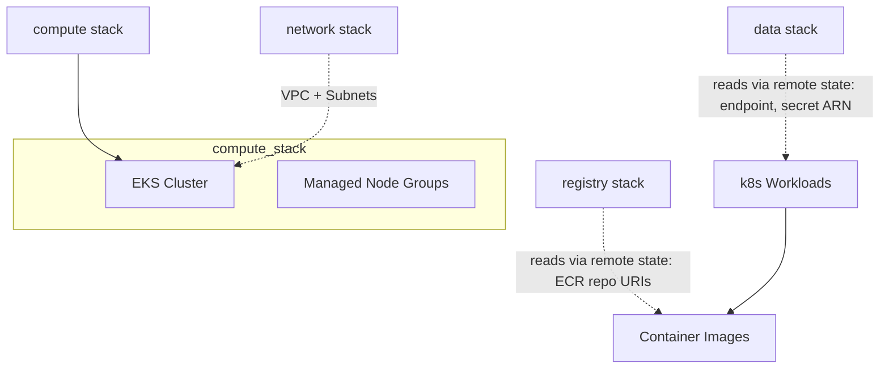

# Compute Stack (EKS)

## Overview

The **compute** stack provisions a shared Amazon EKS (Elastic Kubernetes Service) cluster that hosts all application workloads. It provides the Kubernetes infrastructure where Docker images from ECR are deployed as k8s Deployments, Services, and other resources defined in `k8s/manifests/`.

## Components

| Resource | Description |
|---|---|
| **EKS Cluster** | Managed Kubernetes cluster running the specified K8s version. Public endpoint access can be enabled/disabled via variable. The cluster serves as the compute foundation for all app workloads (users, posts, offers, routes, scores, and orchestrators). |
| **Managed Node Groups** | Auto-scaled node pools that run the pod workloads. Default configuration targets 2 nodes (min: 1, max: 3) with `t3.medium` instance types. |

## Cross-Stack Relationships



- The **network stack** provides the VPC, subnets, and security groups where the EKS cluster is deployed.
- The **compute stack** reads `network_state_path` (via remote state) to access network outputs.
- The **data stack** is referenced via `data_state_path` (remote state) so workloads can access RDS credentials and endpoints.

## Variables

| Variable | Type | Default | Sensitive | Description |
|---|---|---|---|---|
| `region` | `string` | — | No | AWS region (required). |
| `cluster_name` | `string` | — | No | Name of the EKS cluster. |
| `k8s_cluster_version` | `string` | — | No | Kubernetes version for the cluster. |
| `cluster_endpoint_public_access` | `bool` | — | No | Enable/disable public access to the cluster endpoint. |
| `owner` | `string` | — | No | Owner tag for resources (required). |

## Outputs

| Output | Type | Description | Consumed By |
|---|---|---|---|
| `eks_cluster_id` | `string` | ID of the deployed EKS cluster | documentation, kubectl config |
| `secret_token_b64` | `string` | Base64 encoding of the TrueNative authentication token (sensitive). Read from the `SECRET_TOKEN` key of the `secrets-pipeline-native-map` secret (see "TrueNative token" below). The pipeline exports it as `SECRET_TOKEN_B64` for the envsubst step of the `k8s_entrega3` manifests | `k8s_entrega3/k8s-true-native-deployment.yml` |

The cluster ARN, endpoint, CA certificate, OIDC issuer URL and node
group names are deliberately not exposed: the pipeline connects kubectl
with `aws eks update-kubeconfig`, so none of them is consumed, and the
ARN embeds the AWS account id, which is the value of the `ACCOUNT_ID`
environment secret. The deploy pipeline merges every stack output into
a single JSON that GitHub Actions silently discards when it contains a
secret value. The values remain available via `aws eks describe-cluster`
and `aws eks list-nodegroups`.

## TrueNative token (SECRET_TOKEN)

The deploy pipeline uploads every GitHub environment secret except
`AWS_*` and `GITHUB_TOKEN` to the AWS Secrets Manager secret
`secrets-pipeline-native-map` (a JSON map) before applying any stack.
This stack reads the `SECRET_TOKEN` key of that map with a data source
and exposes it, in base64-encoded form, as the `secret_token_b64`
output.

The raw value cannot be exposed as a plain output: the pipeline merges
every stack output into one `tf_outputs` JSON, and GitHub Actions
silently discards a job output when it contains the value of any
in-scope environment secret as a substring. The map's `SECRET_TOKEN`
is exactly such a secret, so re-exposing it raw would poison the whole
combined output and every envsubst render would resolve empty. The
base64 form contains no secret value as a substring, so it crosses the
channel safely; the pipeline exports it as `SECRET_TOKEN_B64` and the
TrueNative manifest fills a K8s Secret `data:` field, which takes
base64 natively. The `6_lambda` stack reads the same map key for the
card worker, so both sides always match. The token never appears in
this repository.

## Deployment Order

Deploy **after** the network stack (depends on its VPC/subnet outputs via remote state). Deploy **after** the data and registry stacks so that workloads have access to DB credentials and container images.

```bash
# From repo root, in order:
cd terraform/stacks/network && terraform apply
cd ../database && terraform apply
cd ../registry && terraform apply
cd ../compute && terraform init -reconfigure
terraform plan \
  -var="region=us-east-1" \
  -var="cluster_name=shared-suitcase-eks" \
  -var="k8s_cluster_version=1.31" \
  -var="cluster_endpoint_public_access=true" \
  -var="owner=pe.trujillo@uniandes.edu.co"
terraform apply

# Configure kubectl
aws eks update-kubeconfig --name shared-suitcase-eks --region us-east-1
```

## Destroy Order

Destroyed **before** the network stack (EKS cluster must be empty before its VPC is deleted).

## Manual Verification

```bash
# Initialize and deploy
cd terraform/stacks/compute
terraform init -reconfigure
terraform plan \
  -var="region=us-east-1" \
  -var="cluster_name=shared-suitcase-eks" \
  -var="k8s_cluster_version=1.31" \
  -var="cluster_endpoint_public_access=true" \
  -var="owner=pe.trujillo@uniandes.edu.co"
terraform apply

# Verify cluster exists
aws eks describe-cluster --name shared-suitcase-eks --region us-east-1 \
  --query 'cluster.[name,status,endpoint]'

# Configure kubectl and list nodes
aws eks update-kubeconfig --name shared-suitcase-eks --region us-east-1
kubectl get nodes
```

## Terraform State Backend

Uses **local backend** by default (`path = terraform.tfstate`). For CI/CD, configure S3 remote in:

```
terraform/environments/<environment>/compute/backend.tfvars
```

Example `backend.tfvars`:

```hcl
bucket         = "my-terraform-state-bucket"
key            = "compute/terraform.tfstate"
region         = "us-east-1"
dynamodb_table = "terraform-locks"
```

## Important Notes for EKS Workloads

After deployment:
1. Run `aws eks update-kubeconfig --name <cluster_name> --region <region>` to configure kubectl.
2. Apply Kubernetes manifests in order (per `config.yaml` → `k8s_manifests:`): `kubectl apply -f k8s/`.
3. Get the OIDC issuer URL with `aws eks describe-cluster` (query `Cluster.OpenIdConnectConfig.Issuer`) for Pod Identity / IRSA role bindings.
4. Workloads can access ECR images by combining registry stack outputs with EKS cluster config.
